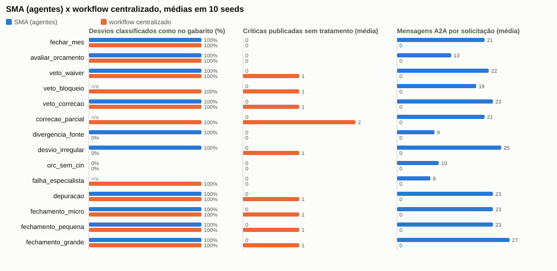

# SMA × workflow centralizado (baseline)

A DSM1 fixou como linha de base um **workflow sequencial único**
({doc}`../dsm1/project_charter`): custos → orçamento → DRE → verificação de regras →
relatório, sem veto, sem consulta entre unidades e sem recurso disputado. A DSM2 revisada
implementa essa linha de base em `src/fin_mas/baseline.py` (CP4), com **as mesmas fórmulas e
as mesmas regras por porte** dos agentes; muda só a coordenação. As duas estratégias rodam
nas mesmas 10 seeds por cenário.

```bash
python -m fin_mas comparar --seeds 10 --out docs/dsm2/resultados   # CSV bruto, JSON, Markdown e SVG
```



```{include} resultados/comparacao.md
```

Dados brutos: `docs/dsm2/resultados/comparacao.csv` (uma linha por cenário, seed e estratégia).

## Leitura

**Onde a coordenação distribuída ganha**

- *Críticas publicadas sem tratamento*: zero no SMA em todos os cenários. No workflow, toda
  crítica plantada é publicada, porque ele não tem poder de veto. Isso confirma a hipótese
  H1 da DSM1, mas por construção: é ausência de mecanismo, não erro de cálculo.
- *Desvios atribuídos a lançamentos irregulares* (`desvio_irregular`) e *divergência
  planilha × ERP* (`divergencia_fonte`): o SMA acerta a classificação contra o gabarito
  (100%) porque o AG-ORC consulta o AG-CIN e reconcilia fontes; o workflow erra (0%) e
  publica um falso desvio.
- *Correção em vez de bloqueio* (`veto_correcao`, `fechamento_*`): o SMA publica limpo depois
  da correção sugerida pelo AG-CIN e da reavaliação; o workflow publica com a crítica.

**Onde ela custa**

- *Mensagens*: entre 8 e 27 mensagens A2A por solicitação, contra nenhuma no workflow.
- *Latência lógica*: maior quando há consulta, veto ou correção (até cerca de 23 ticks
  contra 15); muito maior quando há perda e reenvio (`falha_especialista`: 61).
- *Falha por distribuição*: em `falha_especialista` o SMA falha explicitamente (mensagem
  perdida duas vezes) e o workflow publica. **É o caso em que a solução sofisticada não
  compensa**: sem rede, não há mensagem para perder.
- *Replanejamento não garante acerto*: em `orc_sem_cin` o AG-ORC segue sem a explicação (com
  ressalva) e erra a classificação, como o workflow. A diferença é que ele **declara** que a
  atribuição não foi possível.

## Ameaças à validade

- **Dados sintéticos com plantio**: o gabarito vem do que foi plantado; cenários reais têm
  ruído, erros combinados e ambiguidades que os plantios não cobrem.
- **Baseline mínima**: um workflow centralizado poderia ter laços de correção e consulta
  codificados. O ganho do SMA aqui é estrutural (decisão local com informação de outro
  papel), e o custo de acoplamento dessa alternativa não foi medido.
- **Latência lógica**: um tick é uma unidade do relógio do bus, não tempo de parede. A
  premissa de 3 ticks por etapa no workflow é uma escolha nossa.
- **Amostra**: 10 seeds por cenário; a variação vem dos dados gerados, não da ordem das
  mensagens (o bus é determinístico). Não há concorrência real.
- **Métricas binárias por cenário**: "desvios corretos" é tudo ou nada por execução.

O experimento completo, com perguntas, réplicas e análise de sensibilidade (CP12), fica
para a DSM4.
