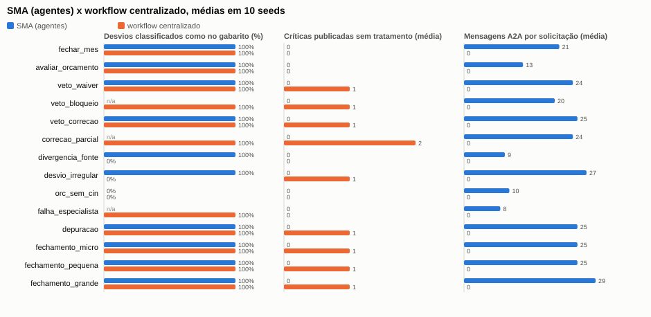

# Coordenação coletiva e evidências

## Mecanismos de coordenação em uso

| Mecanismo | Tipo | Quem decide | Protocolo | Cenário que demonstra |
|---|---|---|---|---|
| Decomposição da intenção em DAG, prazos e reenvio | planejamento (Orquestrador) | AG-ORQ | PROT-SOL, PROT-DEL | `fechar_mes`, `falha_especialista`, `depuracao` |
| Consulta direta entre especialistas | cooperação por informação | o especialista que consulta (AG-RES, AG-ORC) | PROT-QRY | `desvio_irregular`, `orc_sem_cin` |
| Veto com sugestão de correção e reavaliação | negociação com autoridade de veto | AG-CIN (BDI) | PROT-CMP | `veto_correcao`, `correcao_parcial` |
| Decisão humana vinculada ao veto | coordenação humano-agente com política | aprovador + SVC-POL | PROT-APR | `veto_waiver`, `veto_bloqueio`, `ataque_decisao_forjada` |
| Exclusão mútua do período | conflito real de recurso | SVC-LCK | PROT-LCK | `expediente_sma` (fechamentos concorrentes de agosto) |
| Memória entre ciclos | coordenação no tempo (aprendizado de decisões) | AG-CIN + SVC-MEM + SVC-POL | PROT-APR, PROT-CMP | `reincidencia_waiver` |

O comportamento coletivo é observável no trace: em `reincidencia_waiver`, a decisão humana de
agosto (APR-001) vira memória do AG-CIN, que muda a sua crença em setembro; a crença muda o
conteúdo do veto; o veto muda as opções que a política abre; e a decisão do humano em
setembro (correção) é executada pelo Orquestrador via gateway e reavaliada pelo AG-CIN. Nenhum
agente sozinho tem a regra "waiver não se repete": ela emerge de três componentes com
responsabilidades distintas.

## Contract Net: avaliado e não adotado

Na DSM2 ficou planejado avaliar o Contract Net para alocar verificações (CP6). Decisão: **não
adotar nesta entrega**. Cada capacidade tem hoje um único especialista apto (há um AG-CIN, um
AG-CUS etc.); um leilão teria um único proponente, acrescentaria `cfp`/`propose`/`accept` a cada
subtarefa (≥ 3 mensagens) sem mudar a alocação e criaria um ponto de falha a mais. O Contract
Net passa a fazer sentido quando houver verificadores concorrentes (ex.: AG-CIN por porte ou
por regra, com custo e prazo diferentes), o que fica registrado como hipótese para a DSM4.

## Custo de coordenação da DSM3 (MET-16)

Mesmas 10 seeds da DSM2 (`python -m fin_mas comparar --seeds 10`). A qualidade dos resultados
não mudou em nenhum cenário (desvios corretos, críticas publicadas sem tratamento e críticas
corrigidas idênticos). O custo das decisões humanas ficou explícito:

| Cenário (SMA) | Mensagens A2A DSM2 → DSM3 | Latência (ticks) DSM2 → DSM3 | Por quê |
|---|---|---|---|
| `veto_waiver` | 22 → 24 | 18 → 18 | `propose-action` + `approve` |
| `veto_correcao` | 23 → 25 | 21 → 21 | idem |
| `veto_bloqueio` | 19 → 20 | 14 → **32** | o humano não responde: o bloqueio espera o prazo do ticket (20 ticks), em vez de uma mensagem "nenhuma" imediata |
| `correcao_parcial` | 21 → 24 | 19 → **37** | dois tickets; o segundo expira |
| `desvio_irregular`, `depuracao`, `fechamento_*` | +2 | igual | uma decisão humana cada |

Na DSM2, as mensagens do canal livre não eram contadas como A2A; agora a decisão humana é
protocolo e entra na conta, como deve. Resumo global igual ao da DSM2: MET-01 = 79%,
MET-13 = 100%, MET-14 = 69% (era 70%: as decisões do Orquestrador sobre tickets aumentaram o
denominador), MET-07 = 100%, MET-12 = 100%.



```{include} resultados/comparacao.md
```

A ressalva do professor vale aqui: o workflow da tabela não tem veto, correção nem aprovação;
a diferença de qualidade mede a arquitetura completa contra um workflow mínimo. A comparação
com um workflow funcionalmente equivalente é o foco da DSM4 ({doc}`limitacoes`).
