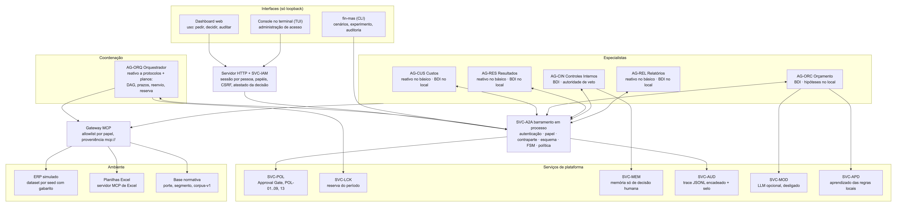

# Arquitetura final

Visão consolidada da versão entregue na DSM4: o que existe, quem decide o quê e em qual ADR está
cada decisão. O detalhe de cada camada continua nas páginas das entregas anteriores, citadas em cada
seção. O relatório técnico (`entregas/dsm4/documentacao/relatorio.pdf`) traz a mesma visão em texto
corrido, com os resultados do experimento.

Fonte editável: `entregas/dsm4/modelos-editaveis/arquitetura_final.mmd`.

## Camadas

| Camada | O que é | Decisão | Página |
|---|---|---|---|
| Interfaces | dashboard web (uso: pedir, decidir, auditar), console TUI (administração de acesso), CLI `fin-mas` (cenários, experimento, auditoria de traces) | web para uso, TUI para administração | {doc}`../dsm3/dashboard`, {doc}`../dsm3/acesso` |
| Fronteira | servidor HTTP só em loopback; SVC-IAM com sessão por pessoa, papéis, CSRF e atestado da decisão | {doc}`../dsm3/ADR-009-identidade-e-acesso` | {doc}`../dsm3/acesso`, {doc}`implantacao` |
| Coordenação | AG-ORQ: decompõe a intenção em DAG, dá prazos, reenvia uma vez, reserva o período, abre o ticket do Approval Gate; não decide conformidade nem desvio | reativo a protocolos com biblioteca de planos | {doc}`../dsm2/coordenacao`, {doc}`../dsm3/coordenacao` |
| Especialistas | AG-CUS, AG-ORC, AG-RES, AG-CIN, AG-REL; BDI ou reativos conforme o nível de cognição (tabela abaixo) | {doc}`ADR-010-especialistas-bdi` | {doc}`cognicao`, {doc}`../dsm3/cognicao` |
| Comunicação | SVC-A2A, barramento em processo com relógio lógico; valida remetente, papel, contraparte, esquema, transição da FSM e política antes de mudar qualquer estado | {doc}`../dsm2/ADR-003-runtime-python-deterministico`, {doc}`../dsm2/ADR-004-a2a-bus-e-mcp-mock`, {doc}`../dsm3/ADR-007-autenticidade-e-approval-gate` | {doc}`../dsm3/protocolos` |
| Serviços | SVC-POL (Approval Gate e política), SVC-LCK (reserva do período), SVC-MEM (memória só de decisão humana), SVC-AUD (trace JSONL encadeado e selado), SVC-MOD (LLM opcional, desligado), SVC-APD (aprendizado das regras locais) | {doc}`../dsm3/ADR-007-autenticidade-e-approval-gate`, {doc}`../dsm3/ADR-008-cognicao-local-e-llm` | {doc}`../dsm3/seguranca`, {doc}`../dsm3/memoria`, {doc}`../dsm3/llm` |
| Ferramentas | gateway MCP com allowlist por papel e proveniência `mcp://` em toda resposta; `erp.corrigir` é o único efeito externo e só com aprovação decidida | {doc}`../dsm2/ADR-004-a2a-bus-e-mcp-mock` | {doc}`../dsm2/arquitetura` |
| Ambiente | ERP simulado gerado por seed com gabarito; planilhas Excel lidas pelo servidor MCP de Excel; base normativa por porte e segmento (`models/portes.yaml`, `models/segmentos.yaml`, `models/conhecimento.yaml`) | {doc}`../dsm2/ADR-006-regras-por-porte-e-planilhas` | {doc}`portes-e-segmentos`, {doc}`../dsm2/planilhas` |
| Implantação | checkout com um comando, wheel com os dados embutidos, contêiner com porta só em loopback; backup selado, restauração com falha fechada | {doc}`../dsm2/ADR-005-execucao-ao-vivo-e-dashboard` | {doc}`implantacao` |
| Fontes (DSM4, ADR-011) | interface `Conector` (ERP simulado, pasta de planilhas, planilha fora do modelo, REST JSON genérico, cliente MCP por stdio) que entrega o modelo canônico; entendimento determinístico de fontes (OpenAPI, amostras JSON, tools MCP, planilha qualquer) com sugestão de mapeamento, confiança e motivo, sempre confirmado por uma pessoa (NORM-30); LLM só sugere, opcional (NORM-31); rede só loopback salvo liberação do administrador (NORM-32) | os agentes veem as mesmas tools: o gateway e a allowlist não mudam | `docs/dsm4/ADR-011-conectores-e-entendimento.md` |
| Acesso avançado (DSM4, ADR-012) | segundo fator TOTP, alçada por pessoa (POL-10), delegação (POL-11), dupla aprovação (POL-12), escalonamento (POL-14), cofre selado, várias empresas por cadastro | estende o SVC-IAM e o Approval Gate sem mudar os traces do nível básico | `docs/dsm4/acesso-avancado.md`, `docs/dsm4/ADR-012-acesso-avancado.md` |

## Quem é BDI e quem é reativo

| Agente | `basico` | `local` | `llm` | LLM permitido |
|---|---|---|---|---|
| AG-ORQ | reativo a protocolos + planos | igual | igual | nunca (NORM-07) |
| AG-CUS | reativo | BDI: critério de rateio | igual a `local` | nunca |
| AG-ORC | BDI sem hipóteses | BDI + hipóteses locais, memória aprovada, aprendizado | + hipóteses por LLM | hipóteses, narrativa |
| AG-RES | reativo | BDI: insumos com prazo, explicação de variação | + comentário por LLM | comentário |
| AG-CIN | BDI | BDI + base normativa | igual a `local` | nunca |
| AG-REL | reativo | BDI: estrutura do relatório | + síntese por LLM | síntese rotulada |

O ADR-010 registra onde a cognição se justifica (AG-RES), onde pesa pouco (AG-CUS: o ganho é
transparência) e onde não se justificou (AG-REL: uma tabela de decisão faria o mesmo). O nível
`basico` é o braço de comparação do experimento e o nível dos cenários revisados da DSM3, cujos traces
não mudaram. O experimento não encontrou ganho significativo do nível `local` na medida registrada
({doc}`resultados`, RQ7).

## Fluxo de um fechamento

1. O solicitante pede `fechar_mes` (PROT-SOL); o Orquestrador reserva o período (PROT-LCK) e delega
   custos e orçamento em paralelo (PROT-DEL).
2. AG-ORC reconcilia planilha e ERP, decide a fonte e, havendo desvio, pergunta direto ao AG-CIN
   (PROT-QRY) se há lançamento irregular na conta; com cognição local, propostas de hipótese viram
   ação epistêmica antes de qualquer sinalização.
3. AG-RES consolida a DRE consultando AG-CUS e AG-ORC (PROT-QRY).
4. AG-CIN dá o parecer (PROT-CMP). Com não conformidade crítica, veta e sugere correção.
5. O veto vira ticket no Approval Gate (PROT-APR): a pessoa com cargo decide; a política confere
   atestado, cargo, segregação de funções, quem pediu e prazo. Corrigir executa `erp.corrigir` pelo
   gateway e o AG-CIN percebe o ERP de novo e reavalia.
6. AG-REL monta o relatório; o Orquestrador publica, libera o período e responde ao solicitante.
   Toda falha termina em resposta explícita (INV-07).

## Propriedades que a arquitetura garante e onde são conferidas

| Propriedade | Mecanismo | Evidência |
|---|---|---|
| Quem calcula não julga conformidade; quem julga não aprova | papéis com `emissores` por performativo em `models/protocols.yaml` | ataques 3 e 8 de `ataque_decisao_forjada` |
| Veto independente | só ROLE-CIN emite `veto`; publicar em VETADO é transição inválida | TEST-08, INV-01 |
| Decisão humana atestada pela pessoa | POL-09, POL-02, POL-03, POL-13 | `ataque_acesso`, INV-04 |
| Efeito externo só com aprovação | gateway + SVC-POL | INV-02, TEST-12 |
| Toda solicitação tem resposta (testado nos parâmetros do experimento e dos testes de caos, não demonstrado) | prazos em todo estado de espera; aviso de mensagem perdida ao iniciador, com a perda marcada pela posição da mensagem na conversa; reentrega dos avisos de decisão humana ao AG-CIN | INV-07, TEST-420, TEST-421, experimento (2.ª e 3.ª rodada) |
| Proposta de modelo não vira crença | cinco regras da NORM-11; evidência determinística | INV-05, INV-06 |
| Reprodutibilidade | relógio lógico, seed, ordem fixa | `cenarios --verificar`, `execucoes.csv` byte a byte |

## Decisões de arquitetura (ADRs)

| ADR | Decisão | Entrega |
|---|---|---|
| {doc}`../dsm1/ADR-002-llm-opcional-por-flag` | LLM opcional, por flag, só em AG-REL, AG-ORC e AG-RES | DSM1 |
| {doc}`../dsm2/ADR-003-runtime-python-deterministico` | runtime Python em processo, relógio lógico, sem SPADE/JADE | DSM2 |
| {doc}`../dsm2/ADR-004-a2a-bus-e-mcp-mock` | barramento A2A e gateway MCP com dados simulados | DSM2 |
| {doc}`../dsm2/ADR-005-execucao-ao-vivo-e-dashboard` | execução ao vivo e dashboard a partir do trace | DSM2 |
| {doc}`../dsm2/ADR-006-regras-por-porte-e-planilhas` | regras por porte e empresas sem ERP | DSM2 |
| {doc}`../dsm3/ADR-007-autenticidade-e-approval-gate` | barramento autenticado e Approval Gate | DSM3 |
| {doc}`../dsm3/ADR-008-cognicao-local-e-llm` | proposta não é crença; motor local e LLM como proponente | DSM3 |
| {doc}`../dsm3/ADR-009-identidade-e-acesso` | identidade e acesso por pessoa | DSM3 |
| {doc}`ADR-010-especialistas-bdi` | todos os especialistas BDI, com as variantes reativas como braço de comparação | DSM4 |
| `docs/dsm4/ADR-011-conectores-e-entendimento.md` | conectores genéricos e entendimento automático de fontes, sem IA generativa | DSM4 |
| `docs/dsm4/ADR-012-acesso-avancado.md` | segundo fator, alçada por pessoa, delegação, quatro olhos, cofre e empresas | DSM4 |
