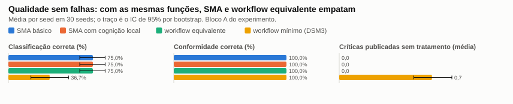
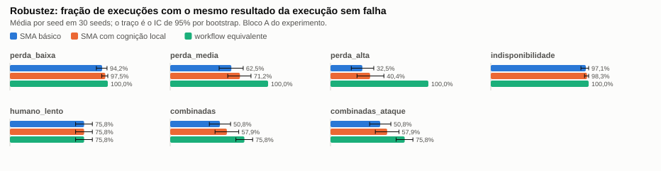
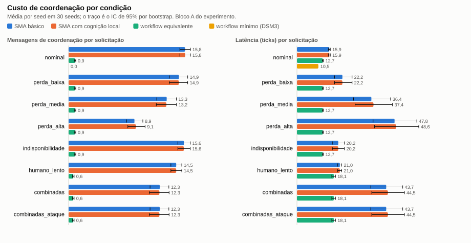
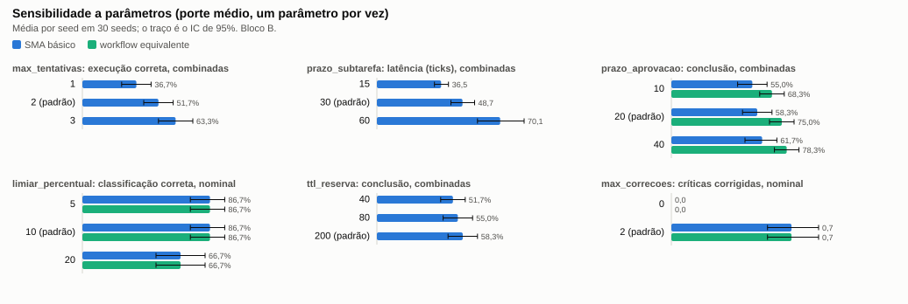
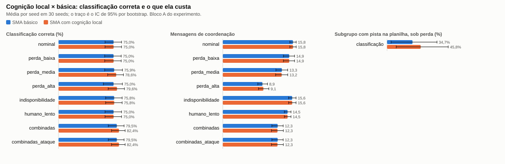
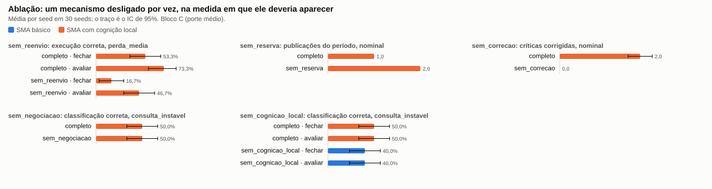

# Experimento da DSM4 — resultados

O desenho está em {doc}`experimento`, escrito e versionado antes de qualquer resultado. Esta
página responde a cada pergunta com os números obtidos, explica o comportamento coletivo
observado, lista o que **não** se confirmou e o que **não** foi testado, e registra os desvios do
pré-registro. Todas as tabelas e todos os testes estão em {doc}`tabelas`; o dado bruto, em
`docs/dsm4/resultados/execucoes.csv`.

```bash
python -m fin_mas experimento --replicas 30 --out docs/dsm4/resultados   # ou: make experimento
```

**O experimento rodou três vezes, e as três contam.** A primeira rodada revelou um defeito do
sistema (resposta perdida virava silêncio); o defeito foi corrigido e a segunda rodada mediu o
sistema corrigido. Depois, uma correção simulada independente da DSM4 achou mais dois defeitos no
mesmo transporte e dois problemas de método no próprio experimento; tudo foi corrigido e a terceira
rodada mede a versão final (1.0.0). Os números desta página são os da terceira rodada, e a seção
"Três rodadas" põe as três lado a lado.

Foram 9.360 execuções em 30 seeds (bloco A: 6.000; B: 2.160; C: 1.080; D: 120). Nenhuma
levantou exceção. Uma segunda execução completa, em outro processo, produz o mesmo
`execucoes.csv` byte a byte (SHA-256 `9d5126a6…` em `manifesto.json`). Os valores abaixo são a
média por seed com o intervalo de confiança de 95% por bootstrap entre colchetes; "pp" é ponto
percentual.

## Resumo

| | Pergunta | Resposta |
|---|---|---|
| RQ1 | Com as mesmas funções, o SMA entrega mais qualidade? | **Não.** Sem falhas, o SMA e o workflow equivalente deram o mesmo resultado nos 240 pares. A vantagem medida na DSM3 era das funções (veto, correção, reconciliação), não do paradigma. O empate é em boa parte construído: o workflow foi escrito e testado até igualar o SMA. |
| RQ2 | Quão robusto é cada braço? | O SMA é **menos** robusto que o workflow sob falha de comunicação: 94,2% de execuções corretas com 5% de perda, 64,2% com 15%, 35,0% com 30%, contra 100% do workflow, que não troca mensagens e por isso não é atingido pelo modelo de falhas. Com 5% a diferença não é significativa (5 seeds diferentes: falta de poder, não ausência de efeito); com 15%, 30% e nas falhas combinadas, é grande. Sob humano lento, empatam (75,8%). Nenhum dos dois publicou crítica sem tratamento. |
| RQ3 | Quanto custa coordenar? E o controle de acesso? | 15,8 mensagens de coordenação por solicitação contra 0,9. A latência a mais (3,2 ticks sem falhas, 31,1 sob falhas combinadas) depende da premissa de 3 ticks por etapa do workflow: com 4 ticks o sinal sem falhas se inverte. O controle de acesso por pessoa não mudou a latência em nenhuma seed; em 2 de 30 a dupla aprovação acrescentou uma mensagem (o aval) e 4 registros de trace. |
| RQ4 | O SMA se recupera? | Responde sempre: 100% de resposta explícita em todas as condições (propriedade testada nos parâmetros do experimento e de TEST-420, atraso até 6 ticks; não demonstrada). Recupera o resultado em 87% das execuções atingidas com 5% de perda, 54% com 15% e 29% com 30%; nas outras, falha de forma explícita ou degrada. A recuperação leva de 27 a 59 ticks na mediana. |
| RQ5 | Depende do porte e dos parâmetros? | A microempresa classifica pior (40,0% contra 86,7%). Tentativas e prazo de subtarefa mexem na robustez e na latência como previsto; o efeito do prazo de aprovação e do TTL da reserva não foi detectado (4 seeds diferentes: o teste não tinha poder para isso); o limiar de 5% não mudou nada. |
| RQ6 | Os ataques passam quando há falha? | No bloco A, **não**: 1.792 ataques ao Approval Gate, nenhum aceito, e a execução atacada terminou igual à não atacada nos 480 pares. No bloco D, 4 de 435 ataques ao controle de acesso foram aceitos sem que a premissa do ataque valesse (decisão legítima pela política); se o ataque muda o desfecho com o controle de acesso ligado (H6b) **não foi testado**. |
| RQ7 | A cognição local melhora o resultado? | **Na medida registrada, não.** Sem falhas, o resultado é idêntico. Sob perda, a classificação correta difere em 2 seeds de 30 e nenhum teste a distingue do acaso. Numa medida que não estava designada (execução correta), o braço local fica de 7 a 9 pp acima do básico sob perda, sem significância. |

A conclusão que os números sustentam, nas três rodadas: para este problema e este tamanho, um
controlador centralizado com as mesmas regras entrega a mesma qualidade, com menos mensagens e
sem a exposição à perda de mensagens. **Com funções iguais, o SMA empata em qualidade e perde em
custo e em robustez sob perda de mensagens. A cognição local não mostrou ganho significativo na
medida registrada.** Nenhuma correção feita ao longo das três rodadas mudou isso. O que a
arquitetura de agentes compra (separação de autoridade entre quem calcula, quem julga a
conformidade e quem aprova; menor privilégio por agente; trilha de quem decidiu o quê) não
aparece em métrica de resultado, e este experimento só o mede indiretamente, pelos ataques
rejeitados.

## Três rodadas

| | Primeira rodada | Segunda rodada | Terceira rodada (versionada) |
|---|---|---|---|
| Código | v0.5.0 como estava | depois da correção do barramento e da integração do acesso avançado e dos conectores | versão final 1.0.0, depois das correções da correção simulada da DSM4 |
| Dados | commit `cfa6b6f` | commit `174e7b6` | commit `45e545b` (`docs/dsm4/resultados/`) |
| SHA-256 do `execucoes.csv` | `c5a4e032…` | `b21fd5d8…` | `9d5126a6…` |
| Papel | revelou o defeito "resposta perdida vira silêncio" | é a que a análise anterior descrevia | mede a versão entregue |

**As correções foram feitas depois de ver resultados.** A correção do barramento foi feita depois
de ver a primeira rodada; as correções da terceira, depois de um avaliador ler a segunda. Por isso
**nenhuma rodada posterior à primeira é teste confirmatório** das hipóteses de robustez e de
recuperação: o sistema foi mudado justamente onde os resultados mostraram que ele falhava, e é
esperado que os números melhorem ali. A segunda e a terceira valem como medida do sistema que
foi entregue em cada momento; como teste de hipótese, vale o que as três têm em comum. As
hipóteses, as métricas, as seeds e as condições são as do pré-registro nas três; o que mudou no
método está em "Desvios do pré-registro".

**Da primeira para a segunda rodada** mudaram três coisas:

1. **A correção** (`core/bus.py`): toda mensagem perdida depois da abertura de uma conversa
   entre agentes agenda um aviso de prazo ao iniciador, que reenvia uma vez ou falha de forma
   explícita. Antes, a resposta perdida não avisava ninguém. O verificador de invariantes
   também foi ajustado (aviso sem transição; parecer do AG-CIN exigido em todo fechamento
   publicado; veto reavaliado em conversa posterior).
2. **O sorteio do atraso de entrega** passou a ser feito no início do envio, antes da validação,
   para a política conferir o prazo do ticket pela entrega real. As condições com atraso
   (`combinadas` e `combinadas_ataque`) não repetem as mesmas realizações da primeira rodada.
3. **O braço "SMA com cognição local" mudou de conteúdo.** Na primeira rodada, o nível local só
   acrescentava as hipóteses do AG-ORC. Na segunda, AG-RES, AG-CUS e AG-REL também são agentes
   BDI nesse nível ({doc}`ADR-010-especialistas-bdi`, {doc}`cognicao`). O braço básico e os dois
   workflows não mudaram.

Entre a análise da segunda rodada e os dados de `174e7b6`, o acesso avançado e os conectores foram
integrados e o experimento foi executado de novo, com o mesmo comando e as mesmas seeds: só 46
linhas mudaram, todas do bloco D com o SVC-IAM ligado. Os números da segunda rodada citados aqui são
os de `174e7b6`.

**Da segunda para a terceira rodada** mudaram quatro coisas, todas apontadas pela correção
simulada da DSM4 ({doc}`limitacoes`, `entregas/dsm4/USO_DE_IA.md`):

1. **O transporte deixou de apagar a marca de perda** (achado C1). Com atraso de entrega de 3
   ticks ou mais, uma mensagem anterior entregue atrasada apagava a marca de que a resposta final
   tinha se perdido, e a solicitação voltava a ficar sem resposta. Agora a perda é marcada pela
   posição da mensagem na conversa (`core/bus.py`; TEST-420). Nas condições do experimento o
   atraso é de no máximo 2 ticks, por isso a segunda rodada não mostrou o defeito.
2. **Os avisos de decisão humana ao AG-CIN passaram a ter reentrega pelo transporte** (achado C2;
   `ENTREGA_GARANTIDA` em `core/bus.py`; TEST-421). Antes, um `waiver_humano` perdido contornava a
   POL-06 ou gerava um segundo ticket. Com os itens 1 e 2, as condições com perda mudam um pouco:
   das 9.360 linhas, 83 têm alguma métrica diferente e 25 têm resultado diferente. Dessas, 23 são
   fechamentos das seeds 25 e 27 com 15% ou 30% de perda (8 em `perda_media`, 12 em `perda_alta`
   e 3 no bloco C) que passaram de falha explícita a resultado certo; as outras 2 são as do item 3.
3. **O bloco D passou a ter duas pessoas no roteiro de aprovação** (achado M2; `SEGUNDA_PESSOA` em
   `caos.py`). Com uma só, a dupla aprovação (POL-12) recusava a liberação acima do limite do porte
   e o ticket expirava: nas seeds 24 e 25 o fechamento terminava bloqueado, e o bloco D media a
   falta da segunda pessoa, não o custo do controle de acesso. Essas duas execuções bloqueadas
   contavam como "execução correta" na segunda rodada, porque a execução sem falhas do próprio
   bloco D, que serve de referência, também estava bloqueada (ver RQ3).
4. **Os testes da RQ4 passaram a usar a seed como unidade** (achado M9; `estudo.comparar_grupos`).
   Antes, cada execução era uma observação, o que é pseudo-replicação: execuções da mesma seed
   compartilham dados e perdas. A versão do pacote no registro `meta` do trace passou a 1.0.0, o
   que muda o hash de todas as linhas sem mudar nenhuma métrica.

Os números principais, lado a lado (SMA básico, salvo indicação):

| Medida | 1.ª rodada | 2.ª rodada | 3.ª rodada | Workflow equivalente |
|---|---|---|---|---|
| Pares diferentes do workflow, sem falhas (RQ1) | 0 de 240 | 0 de 240 | 0 de 240 | — |
| Execução correta, perda de 5% | 80,0% | 94,2% | 94,2% | 100% |
| Execução correta, perda de 15% | 48,8% | 62,5% | 64,2% | 100% |
| Execução correta, perda de 30% | 22,5% | 32,5% | 35,0% | 100% |
| Execução correta, indisponibilidade | 92,1% | 97,1% | 97,1% | 100% |
| Execução correta, humano lento | 75,8% | 75,8% | 75,8% | 75,8% |
| Execução correta, falhas combinadas | 45,4% | 50,8% | 50,8% | 75,8% |
| Resposta explícita, perda de 5% / 15% / 30% | 88,8% / 73,8% / 52,9% | 100% nas três | 100% nas três | 100% |
| Execuções do SMA com invariante violado | 807 de 6.480 (INV-07) | 0 de 6.480 | 0 de 6.480 | não se aplica |
| Mensagens de coordenação, sem falhas | 15,75 | 15,75 | 15,75 | 0,88 |
| Latência, sem falhas (ticks) | 15,89 | 15,89 | 15,89 | 12,71 |
| Latência, falhas combinadas (ticks) | 43,7 (só as 28 seeds com resposta) | 49,2 | 49,2 | 18,1 |
| Críticas publicadas sem tratamento | 0 | 0 | 0 | 0 |
| Ataques aceitos indevidamente | 0 de 1.735 | 0 de 2.227 | 0 de 2.227 | não atacado |
| Ataques aceitos sem a premissa (bloco D) | 8 | 4 | 4 | não atacado |
| Ablação do reenvio, perda de 15% (com × sem) | 40,0% × 28,3% (não significativo) | 61,7% × 31,7% (p ajustado < 0,001) | 63,3% × 31,7% (p ajustado < 0,001) | — |
| RQ4, recuperação local × básico | p ajustado 0,60 (execuções) | p ajustado 0,031 (execuções) | p ajustado 0,26 (seeds) | — |

**O que as correções mudaram.** (1) Da primeira para a segunda: toda solicitação passou a receber
resposta (as 807 execuções sem resposta viraram resultado certo ou falha explícita); a robustez do
SMA subiu de 5 a 14 pp em todas as condições de falha de comunicação; o reenvio do Orquestrador,
que antes não tinha efeito distinguível do acaso, passou a ter efeito grande, porque agora ele é
acionado nos casos que antes travavam; mais tentativas deixaram de derrubar a resposta explícita;
e com 5% de perda a diferença para o workflow deixou de ser significativa. (2) Da segunda para a
terceira: 1,7 pp a mais de execuções corretas com 15% de perda e 2,5 pp com 30%, pelas mudanças do
transporte (duas seeds); o bloco D deixou de medir a falta da segunda pessoa; e a diferença de
recuperação entre o braço local e o básico, que parecia significativa com a execução como unidade
(p = 0,031), deixou de ser (p = 0,26) com a seed como unidade.

**O que as correções não mudaram.** (1) O SMA continua perdendo em robustez para o workflow
equivalente em toda condição de falha de comunicação, e por muito a partir de 15% de perda:
35,8 pp a menos com 15%, 65,0 pp com 30%, 25,0 pp nas falhas combinadas. Responder sempre não é
o mesmo que acertar: com 30% de perda, 139 das 240 execuções do SMA básico terminam em falha
explícita. (2) O custo de coordenação é o mesmo, e a latência sob falha ficou **maior** que na
primeira rodada, porque as execuções que antes travavam agora esperam o prazo, reenviam e entram
na média. (3) A qualidade com funções iguais continua empatada. (4) Nenhuma crítica publicada sem
tratamento e nenhum ataque aceito indevidamente, nas três.

## A amostra

Os sorteios são da seed, então vale dizer o que saiu. Nas 30 seeds: 20 aprovadores diligentes e
10 cautelosos; **nenhum** rigoroso (a probabilidade era 0,10; por acaso não saiu). Plantios:
alçada em 11 seeds, SoD em 8, duplicidade em 11, competência em 11, desvio orçamentário em 11,
divergência de fonte em 10 e desvio irregular em 10 (em 4 delas com a observação parafraseada);
2 seeds sem plantio. Como as chaves de sorteio da perda não dependem do porte nem da intenção,
uma mensagem que se perde numa seed se perde nas 8 células daquela seed: os efeitos aparecem
em blocos de seed, e por isso a unidade estatística é a seed (n = 30), não a execução.

## RQ1 — qualidade com funções iguais



- **H1a confirmada, nas três rodadas — e em boa parte por construção.** SMA básico e workflow
  equivalente: 0 pares diferentes em 240 (status, DRE, contas sinalizadas, contas atribuídas e
  correções). Classificação correta de 75,0% [63,3%; 85,8%] nos dois; conformidade e DRE corretas
  em 100%; nenhuma crítica publicada sem tratamento. O workflow foi escrito depois do SMA, lendo
  os agentes, e conferido por teste até dar o mesmo resultado: o empate mostra que a equivalência
  foi alcançada, não que dois desenhos independentes convergiram.
- **H1b confirmada.** O workflow mínimo da DSM3 classifica certo em 36,7% [20,0%; 53,3%]
  (38,3 pp a menos [23,3; 53,3], p ajustado < 0,001, delta de Cliff 0,33) e publica 0,68 crítica
  sem tratamento por execução [0,55; 0,82] (delta −0,93). A conformidade ele acerta em 100%:
  enxerga os mesmos achados, só não tem o que fazer com eles.

A crítica do professor estava certa. Quando o workflow recebe veto, correção, aprovação,
reconciliação de fontes e atribuição de desvio, a diferença de qualidade some. A equivalência
é conferida por teste (`tests/e2e/test_equivalencia_workflow.py`) nos 11 cenários comparáveis da
DSM3 e em cargas sorteadas fora das seeds do experimento, com mais campos do que a hipótese
pedia (KPIs, totais e forecast, achados, número de ressalvas e de notas, decisões do Approval
Gate).

A classificação não chega a 100% em nenhum braço por três situações em que o gabarito pede o que
uma resposta de rótulo único não dá; estão em "Ameaças à validade".

## RQ2 — robustez sob falha



| Condição | SMA básico | Workflow equivalente | Diferença | Seeds diferentes | p ajustado |
|---|---|---|---|---|---|
| `perda_baixa` (5%) | 94,2% [88,3%; 99,2%] | 100% | −5,8 pp [−11,7; −0,8] | 5 | 0,125 |
| `perda_media` (15%) | 64,2% [51,2%; 76,7%] | 100% | −35,8 pp [−48,8; −23,3] | 19 | < 0,001 |
| `perda_alta` (30%) | 35,0% [22,9%; 47,5%] | 100% | −65,0 pp [−77,1; −52,5] | 28 | < 0,001 |
| `indisponibilidade` | 97,1% [92,1%; 100%] | 100% | −2,9 pp [−7,9; 0,0] | 2 | 0,500 |
| `humano_lento` | 75,8% [67,1%; 84,2%] | 75,8% [67,1%; 84,2%] | idêntico em todos os pares | 0 | — |
| `combinadas` | 50,8% [40,0%; 61,7%] | 75,8% [67,1%; 84,2%] | −25,0 pp [−37,1; −14,2] | 14 | < 0,001 |

- **H2a confirmada** para 15% e 30% de perda e para as falhas combinadas, com efeito grande
  (delta de Cliff −0,63, −0,93 e −0,45). Para 5% de perda e para a indisponibilidade de um
  especialista, a diferença tem o sinal previsto e **não é significativa**, com 5 e 2 seeds
  diferentes. Com 5 seeds diferentes, o menor p possível do Wilcoxon exato bilateral é 0,0625;
  com 2, 0,50. Esses "não significativos" são falta de poder do desenho, não evidência de que a
  diferença não existe. Na primeira rodada, antes da correção, os 5% de perda eram
  significativos.
- **H2b confirmada, com uma ressalva de construção:** 94,2% > 64,2% > 35,0% (p ajustado < 0,001
  nas duas comparações). As perdas são sorteadas com números aleatórios comuns: a n-ésima
  ocorrência de uma mensagem usa o mesmo sorteio nos três níveis, e se perde quando ele fica
  abaixo da probabilidade. Enquanto as execuções seguem o mesmo caminho, toda mensagem perdida com
  5% também se perde com 15% e com 30%. A queda monotônica é, em parte, consequência desse
  aninhamento e não só do sistema.
- **H2c confirmada:** com humano lento os dois braços têm exatamente o mesmo resultado. O ticket
  expira nos dois e a publicação fica bloqueada (58 de 240 execuções em cada um).
- **H2d confirmada:** nenhuma crítica publicada sem tratamento em nenhuma execução do SMA ou do
  workflow equivalente, em nenhuma condição. Quando falha, o SMA falha fechado.

O workflow ganha por construção: ele não tem mensagens entre componentes, e o modelo de falhas
só atinge essas mensagens. O que o experimento acrescenta é o tamanho da conta. Depois da
correção, 5% de perda por mensagem custam pouco; a partir de 15%, mais de um terço das
solicitações do SMA não termina com o resultado certo, e o mecanismo de recuperação (um reenvio
por subtarefa) não dá conta.

## RQ3 — custo de coordenação e do controle de acesso



- **H3a confirmada em mensagens; em latência, só sob a premissa do workflow.** Sem falhas: 15,75
  mensagens de coordenação por solicitação no SMA contra 0,88 no workflow (14,87 a mais
  [14,20; 15,53]) e 15,89 ticks contra 12,71 (3,18 a mais [2,87; 3,48]). Por intenção: fechar o
  mês custa 23,5 mensagens e 21,6 ticks no SMA contra 1,8 e 19,4; avaliar o orçamento, 8,0 e 10,2
  contra 0 e 6,0. Sob falhas combinadas: 13,60 mensagens contra 0,64 e 49,2 ticks contra 18,1
  (31,1 a mais [25,0; 37,5]). Todas com p ajustado < 0,001 e delta de Cliff entre 0,89 e 1,00.
- **A latência entre os braços é modelada, não medida.** No SMA, um tick é o relógio lógico do
  barramento; no workflow, cada etapa custa 3 ticks por premissa (`TICKS_POR_ETAPA` em
  `baseline_eq.py`, a mesma do `baseline.py` da DSM3) mais a espera pelo aprovador. Os "3,18
  ticks a mais" dependem dessa premissa. Refazendo só o workflow com outras premissas
  (exploratório, fora do pré-registro, calculado por `tools/relatorio_numeros.py`): sem falhas,
  8,8 ticks com 2 por etapa, 16,7 com 4 e 20,6 com 5. **Com 4 ticks por etapa o sinal se
  inverte** e o workflow fica mais lento que o SMA (15,89). Sob falhas combinadas o SMA continua
  mais lento até 5 ticks por etapa (25,0 contra 49,2), porque ali pesa a espera pelos prazos de
  reenvio. A conclusão firme da RQ3 é a de mensagens; a de latência sem falhas não se sustenta sem
  a premissa.
- **H3b: o controle de acesso não custou latência; a previsão de mais auditoria no trace não se
  confirmou.** Comparação do bloco D (SVC-IAM ligado) com as mesmas seeds do bloco A no porte
  médio (SVC-IAM desligado), sem falhas: latência idêntica em todos os pares (15,9 ticks);
  mensagens 18,70 contra 18,67 e registros de trace 141,0 contra 140,9, por diferença em 2 seeds
  de 30 (24 e 25, fechamento), em que a liberação acima do limite do porte exige a dupla
  aprovação e o aval da segunda pessoa acrescenta uma mensagem e 4 registros (p = 0,50 sem
  correção); nenhuma mensagem rejeitada dos dois lados. Com falhas combinadas e ataques, o SVC-IAM
  ligado tem 7,25 ataques tentados por solicitação contra 3,50 (só o bloco D recebe os ataques ao
  controle de acesso), 5,68 mensagens rejeitadas contra 2,75 e 135,4 registros contra 130,7, com
  latência de 48,5 contra 48,7 ticks. **A execução correta não serve para essa comparação:** ela
  compara cada execução com a mesma execução sem falhas *do mesmo bloco*, então sem falhas ela é
  100% dos dois lados por definição (a execução nominal comparada com ela mesma, `estudo.py`). Com
  falhas, 55,0% com o SVC-IAM contra 51,7% sem, mas as duas condições não diferem só pelo
  controle de acesso (os ataques também são outros). O que o controle de acesso registra a mais
  vai para a trilha de acesso, que é outro arquivo e não foi medida. Tempo de parede (não
  reproduzível, uma rodada, `tempo_parede.csv`): mediana de 8,0 ms por execução com o SVC-IAM
  contra 5,2 ms sem ele, no porte médio, 60 execuções de cada lado.

## RQ4 — recuperação

Execução "atingida": houve pelo menos uma mensagem perdida ou um prazo esgotado na solicitação.

| Condição (SMA básico) | Atingidas | Mesmo resultado da nominal | Degradação segura | Sem resposta | Recuperação (mediana) |
|---|---|---|---|---|---|
| `perda_baixa` | 105 de 240 | 91 (87%) | 14 | 0 | 27 ticks |
| `perda_media` | 189 | 103 (54%) | 86 | 0 | 46 ticks |
| `perda_alta` | 220 | 64 (29%) | 156 | 0 | 59 ticks |
| `indisponibilidade` | 57 | 50 (88%) | 7 | 0 | 33 ticks |
| `combinadas` | 176 | 58 (33%) | 118 | 0 | 54 ticks |

- **H4a confirmada para falhas leves e, por pouco, para 15% de perda;** refutada para 30% de
  perda (29%) e para as falhas combinadas (33%). Na primeira rodada só as falhas leves passavam
  da metade (54% e 67%).
- **H4b confirmada:** a mediana da recuperação fica entre 27 e 59 ticks, acima dos 10 de um
  prazo de consulta. Recuperar custa, em geral, um prazo de subtarefa (30 ticks).
- **H4c (execuções sem resposta) confirmada na primeira rodada e eliminada a partir da segunda.**
  Antes da correção ficaram sem resposta 27, 63 e 113 das 240 execuções com 5%, 15% e 30% de
  perda, 12 com um especialista fora do ar e 40 nas combinadas. Depois, nenhuma. A "degradação
  segura" da tabela é quase toda falha explícita: o Orquestrador reenvia uma vez e, se perde de
  novo, responde `failure`.
- **"Sempre responde" é propriedade testada, não demonstrada.** Vale nas 6.480 execuções do SMA
  deste experimento (atraso de entrega de até 2 ticks) e nos testes de caos com atraso de 3 a 6
  ticks e perda (TEST-420). A segunda rodada também respondia sempre e, ainda assim, o transporte
  tinha o defeito C1, que só aparecia com atraso de 3 ticks ou mais: fora dos parâmetros testados
  não há garantia. A reentrega garantida dos avisos de decisão humana para em 5 tentativas.

**Tipo de falha e braço** (Mann-Whitney com a seed como unidade, desvio declarado). Recuperar de
perda de mensagem leva mais tempo que recuperar de indisponibilidade: 50,6 contra 33,0 ticks na
média das médias por seed (30 seeds com perda, 13 com execução atingida pela indisponibilidade;
p ajustado 0,0016, delta de Cliff 0,65). O braço com cognição local leva 53,7 ticks contra 49,1 do
básico (30 × 30 seeds; p = 0,26, delta 0,17): **não significativo**. Com a execução como unidade,
como na segunda rodada, a mesma diferença dava p = 0,031; aquele p vinha de tratar as 747
execuções de cada braço como independentes, quando as 8 células de uma seed compartilham dados e
perdas (pseudo-replicação). O desvio de unidade foi feito depois de ver os resultados e está
declarado em "Desvios".

## RQ5 — porte e parâmetros



**Porte.** Classificação correta de 40,0% [23,3%; 56,7%] na microempresa contra 86,7% nos outros
três portes (46,7 pp a menos [−63,3; −30,0], p ajustado 0,001). **H5a confirmada:** nas 20
execuções da micro com divergência de fonte, as 20 erram, porque sem ERP não há segunda fonte
para reconciliar. Mas a divergência não explica tudo: outras 16 das 40 execuções da micro
também erram, por dois efeitos da geração de dados nesse porte (ver ameaças). O custo de
coordenação não muda com o porte (15,7 a 15,9 mensagens). O workflow equivalente tem os mesmos
números de classificação em todos os portes. O experimento cobre os quatro portes do
pré-registro; MEI e Média empresa II, que entraram no sistema depois, ficam de fora.

**Parâmetros** (porte médio, um por vez; H5b; o bloco B saiu idêntico nas duas últimas rodadas):

| Parâmetro | O que se viu | Veredito |
|---|---|---|
| Máximo de tentativas 1 / 2 / 3 | execução correta sob falhas combinadas: 36,7% / 51,7% / 63,3% (1 × 3: −26,7 pp [−40,0; −15,0], p ajustado 0,001). O custo é latência: 29,9 / 48,7 / 57,1 ticks. | confirmada |
| Prazo de subtarefa 15 / 30 / 60 | latência sob falhas combinadas: 36,6 / 48,7 / 70,1 ticks (15 × 60: −33,6 [−45,2; −23,2], p ajustado < 0,001). A robustez muda pouco (50,0% / 51,7% / 56,7%). | confirmada |
| Prazo de aprovação 10 / 20 / 40 | fechamentos publicados sob falhas combinadas: 20,0% com prazo 10 contra 33,3% com 40 (4 seeds diferem; p = 0,125, o menor possível com 4 seeds). No workflow, onde só o humano atrapalha, 68,3% / 75,0% / 78,3%. | sentido previsto, **sem poder para decidir** |
| Limiar de desvio 5% / 10% / 20% | 5%: nada muda (idêntico em todos os pares). 20%: a classificação cai de 86,7% para 66,7% (−20 pp [−33,3; −6,7], p = 0,031, ajustado 0,094). | **refutada para 5%**; para 20%, não significativa após a correção de Holm |
| TTL da reserva 40 / 80 / 200 | fechamentos publicados sob falhas combinadas: 13,3% com TTL 40 contra 26,7% com 200 (4 seeds; p = 0,125, o menor possível). | sentido previsto, **sem poder para decidir** |
| Máximo de correções 0 / 2 | críticas corrigidas no fechamento: 0 contra 1,33; publicação sem falhas cai de 100% para 83,3% (o aprovador cauteloso bloqueia o que não pode corrigir). p ajustado < 0,001. | confirmada |

## RQ6 — ataques sob falha

- **H6a confirmada no bloco A.** 1.792 ataques ao Approval Gate em 128 execuções atacadas, com
  perda, atraso, indisponibilidade e humano lento ao mesmo tempo; 0 aceitos.
- **H6a no bloco D: nenhum aceito indevidamente, mas 4 aceitos.** Com o SVC-IAM ligado, 435 ataques
  ao controle de acesso em 15 execuções; 4 registrados como aceitos (fechamento, seeds 3, 7, 15 e
  28), todos o mesmo ataque: "aprovador que participou do lançamento vetado decide sobre ele". O
  ataque supõe que a analista ana participou do lançamento; nesses 4 casos ela não estava entre
  os envolvidos do ticket, e a decisão dela é a de uma aprovadora autorizada, com atestado válido
  e sem conflito, que a política aceita corretamente (aceito sem a premissa do ataque). A decisão
  foi emitida pelo roteiro de ataque, mas é legítima.
- **H6b confirmada só no bloco A.** A execução atacada terminou com o mesmo resultado da mesma
  execução sem ataque nos 240 pares do SMA básico e nos 240 do SMA com cognição local.
- **H6b não foi testada no bloco D.** O desenho não tem o par designado (SVC-IAM ligado, com e sem
  os ataques ao controle de acesso). O avaliador da correção simulada rodou esse par por conta
  própria na versão anterior e encontrou 2 de 60 pares com desfecho diferente (seeds 7 e 28): o
  fechamento passava de bloqueado a publicado por uma decisão "ana corrige" emitida pelo roteiro de
  ataque, legítima pela política. Nos dados finais, o único par disponível é outro (bloco D com
  ataques × bloco A com `combinadas_ataque`, SVC-IAM desligado e ataques só ao Approval Gate), e ele
  difere exatamente nessas 2 seeds de 60 (bloqueado × publicado com ressalva). Esse par mistura o
  controle de acesso com os ataques e não testa H6b; o que ele mostra é que, no bloco D, o roteiro
  de ataque **mudou o desfecho** em 2 fechamentos, por uma decisão que a política aceita.

Só há ataque quando há veto pendente (os ataques miram o Approval Gate), por isso 128 de 480
execuções do bloco A foram atacadas; são mais que na primeira rodada (97) porque menos execuções
travam antes de chegar ao veto. O workflow equivalente não foi atacado: a bateria de ataques é
contra o barramento de agentes.

## RQ7 — cognição local



O braço mudou de conteúdo entre a primeira e a segunda rodada (ver "Três rodadas" e "Desvios"):
além das hipóteses do AG-ORC, os agentes de Resultados, Custos e Relatórios são BDI. O que se mede
aqui é esse pacote inteiro contra o SMA básico.

- **H7a confirmada.** Sem falhas, 0 pares diferentes em 240, nenhuma mensagem e nenhum tick a
  mais. O custo aparece em decisões e em trace: 18,0 decisões registradas por solicitação
  contra 13,4, e 253,5 registros de trace por fechamento contra 181,7. As hipóteses do AG-ORC
  seguem como antes (0,23 confirmada e 0,03 refutada por execução).
- **H7b não confirmada.** Na medida registrada, a classificação correta, o braço local fica um
  pouco acima sob perda média (75,3% contra 72,5%), perda alta (73,7% contra 69,8%) e falhas
  combinadas (79,5% contra 78,6%), sempre por 2 seeds em 30, e nenhum teste distingue a
  diferença do acaso (p entre 0,5 e 1,0; com 2 seeds diferentes o menor p possível é 0,50). No
  subgrupo registrado (desvio irregular com pista na planilha, sob perda) sobraram 6 seeds: 41,7%
  contra 30,6%, uma única seed diferente. É o mesmo quadro das rodadas anteriores.
- **H7c não confirmada.** Mensagens de coordenação sob perda média: 16,02 contra 15,49 (0,53 a
  mais [−0,13; 1,27], p = 0,17).

**O ganho da cognição apareceu?** Na hipótese que foi registrada, não. Há um sinal numa medida
que não era a designada, e ele precisa ser lido como exploratório: a execução correta do braço
local fica acima da do básico em todas as condições de falha de comunicação.

| Condição | SMA básico | SMA com cognição local | Diferença | Seeds diferentes | p (sem correção) |
|---|---|---|---|---|---|
| `perda_baixa` | 94,2% | 97,5% | +3,3 pp [0,0; 8,3] | 2 | 0,50 |
| `perda_media` | 64,2% | 72,9% | +8,8 pp [0,4; 18,3] | 6 | 0,063 |
| `perda_alta` | 35,0% | 42,9% | +7,9 pp [1,7; 16,3] | 4 | 0,125 |
| `indisponibilidade` | 97,1% | 98,3% | +1,3 pp [0,0; 3,8] | 1 | 1,00 |
| `combinadas` | 50,8% | 57,9% | +7,1 pp [−0,4; 16,7] | 5 | 0,125 |

Nenhuma dessas diferenças é significativa, nem antes de corrigir para cinco comparações. Elas
não constavam do plano de análise, foram calculadas depois de ver os dados e vêm de um braço
cujo conteúdo mudou depois do pré-registro. O que se pode dizer: o sinal é consistente no
sentido (em 24 execuções com 15% de perda o braço local acerta onde o básico falha, e em 3
acontece o contrário), é pequeno, e este experimento não tem poder para afirmá-lo. Mesmo com
ele, o braço local continua muito abaixo do workflow equivalente: 72,9% contra 100% com 15% de
perda, 42,9% contra 100% com 30%.

## Ablação



Base: SMA com cognição local e tudo ligado (com os especialistas BDI), porte médio, desvio
irregular sempre plantado e, no fechamento, um segundo pedido do mesmo mês 2 ticks depois.

| Mecanismo desligado | Medida designada | Com o mecanismo | Sem | Leitura |
|---|---|---|---|---|
| Reenvio do Orquestrador | execução correta, 15% de perda | 63,3% | 31,7% | −31,7 pp [−46,7; −18,3], 13 seeds, p ajustado < 0,001, delta −0,41. **É o mecanismo de recuperação que funciona.** Na primeira rodada a diferença era de 11,7 pp e não significativa: o reenvio só passou a valer para a resposta perdida depois da correção. |
| Reserva de período | publicações do mesmo mês, sem falhas | 1,00 | 2,00 | Nas 30 seeds, os dois pedidos concorrentes são publicados e 1,37 correção por execução falha por já ter sido feita pelo outro. p ajustado < 0,001. Igual nas três rodadas. |
| Veto com correção | críticas corrigidas, sem falhas | 2,00 | 0 | Sem correção, o diligente concede waiver e o cauteloso bloqueia: a publicação cai de 100% para 66,7%. p ajustado < 0,001. Igual nas três rodadas. |
| Negociação de prazo | classificação correta, consulta instável, avaliação orçamentária | 50,0% | 50,0% | **Sem efeito na medida designada**, nas três rodadas. A negociação foi acionada em 6 de 30 execuções; em uma seed ela levou ao resultado da execução sem falha (execução correta 73,3% contra 70,0%). |
| Cognição local | classificação correta, consulta instável | 50,0% | 40,0% | −10,0 pp [−23,3; 0,0], 3 seeds, p = 0,25 (o menor possível com 3 seeds): **não significativo**, nas três rodadas. Na execução correta, 73,3% contra 56,7% (avaliação) e 70,0% contra 56,7% (fechamento). |

Três dos cinco mecanismos têm contribuição clara: reserva, correção e, depois da correção do
barramento, reenvio. A negociação de prazo não mostrou efeito. A cognição local aponta no
sentido esperado sem significância na medida designada; fora dela (exploratório), no fechamento
com 15% de perda, a execução correta cai de 53,3% para 33,3% quando a cognição local é desligada
(6 seeds, p = 0,031 sem correção).

## Comportamento coletivo observado

**Quem decidiu o quê.** No SMA básico sem falhas, 77% das decisões registradas foram tomadas
fora do Orquestrador (17,2 decisões por fechamento, contra 6,1 do controlador único, que toma
todas); com os especialistas BDI, 84% (24,7 decisões por fechamento). O AG-ORC decide a fonte e
a classificação de cada desvio e pergunta ao AG-CIN, sem passar pelo Orquestrador, se há
lançamento irregular na conta. O AG-CIN decide o parecer e, depois de uma correção, percebe o
ERP de novo e reconsidera (2,0 reconsiderações de intenção por fechamento). O humano decide no
Approval Gate (0,88 decisão por fechamento, em média). O Orquestrador decide a ordem, os prazos
e os reenvios. No workflow, as mesmas regras rodam em sequência dentro de um componente que lê
todas as fontes, julga a conformidade e executa a correção.

**Onde a distribuição custou.** (1) Mensagens: cada decisão local precisa de uma troca para ser
conhecida pelos outros. (2) Exposição: cada troca pode se perder; a 15% de perda, 64,2% das
solicitações terminam certas, e a 30%, pouco mais de um terço. (3) Recuperar leva tempo: de 27 a
59 ticks na mediana, de duas a quatro vezes uma solicitação inteira sem falha. (4) Um reenvio por
subtarefa é pouco quando a perda é alta: com 30%, 139 de 240 execuções acabam em falha explícita.

**Onde a distribuição ajudou.** (1) Em nada que este experimento meça como resultado, quando as
funções são iguais; é o achado central, nas três rodadas. (2) Na contenção, com uma ressalva. No
bloco A, os 1.792 ataques ao Approval Gate, vindos de identidades falsas, de agentes legítimos
fora do seu papel e da caixa do aprovador sem a pessoa certa, foram todos rejeitados mesmo com o
sistema já degradado, e nenhum mudou o desfecho (480 pares). No bloco D, nenhum dos 435 ataques
ao controle de acesso foi aceito indevidamente, mas 4 foram aceitos porque a premissa do ataque
não valia, e em 2 fechamentos o desfecho mudou por uma decisão legítima emitida pelo roteiro de
ataque; se o ataque muda o desfecho com o controle de acesso ligado não foi testado (RQ6). A
contenção depende de cada agente ter um papel, uma credencial e uma lista de ferramentas; no
workflow, o controlador único acumula tudo e o experimento não tinha como atacá-lo do mesmo modo.
(3) Na concorrência: a reserva de período é a única coisa que impede dois fechamentos do mesmo
mês de serem publicados; sem ela isso aconteceu em 30 de 30 execuções.

**O que as falhas não quebraram.** Nenhuma crítica publicada sem tratamento em 6.480 execuções do
SMA, em nenhuma das rodadas. Na segunda e na terceira, nenhum invariante violado: nem publicação,
nem efeito externo, nem protocolo, nem crença, nem segredo, nem resposta explícita. Nenhum
invariante cobre "uma liberação humana por veto" ({doc}`limitacoes`).

## O que não se confirmou

1. **H7b e H7c (cognição local):** a classificação correta não melhora de forma distinguível do
   acaso, e não houve mais mensagens. O sinal na execução correta é exploratório e não
   significativo.
2. **H2a para 5% de perda e para a indisponibilidade de um especialista:** diferença no sentido
   previsto, não significativa, com 5 e 2 seeds diferentes (sem poder para decidir).
3. **H4a para 30% de perda e para as falhas combinadas:** a maioria das execuções atingidas não
   recupera o resultado; termina em falha explícita.
4. **H5b para o limiar de 5%** (nenhum efeito), **para o limiar de 20%** (não significativo após
   Holm), **para o prazo de aprovação e para o TTL da reserva** (4 seeds diferentes; o menor p
   possível é 0,125).
5. **H3b na parte dos registros de auditoria:** o trace quase não cresce com o controle de acesso.
6. **H3a na latência sem falhas, fora da premissa:** com 4 ticks por etapa no workflow, o SMA
   deixa de ser mais lento.
7. **Ablação da negociação de prazo e da cognição local:** contribuição não distinguível do
   acaso com 30 seeds, nas três rodadas.
8. **A expectativa de zero violações de invariantes, na primeira rodada:** 807 das 6.480
   execuções do SMA violaram o INV-07 (resposta explícita). Na segunda e na terceira, zero.

## O que não foi testado

1. **H6b com o controle de acesso ligado.** Não há o par designado (bloco D com e sem os ataques
   ao acesso); ver RQ6.
2. **Latência real.** A latência entre os braços é modelada (premissa de ticks por etapa no
   workflow); nenhum tempo de parede entra em teste.
3. **"Sempre responde" fora dos parâmetros.** Atraso de entrega acima de 6 ticks, agente fora do
   ar por mais que as 5 tentativas da reentrega garantida, rajadas e partição de rede.
4. **Robustez de um workflow distribuído.** O workflow equivalente roda num processo e não tem
   mensagens a perder; um controlador com serviços remotos não foi construído.
5. **MEI e Média empresa II, aprovador rigoroso e um Orquestrador que cai** (ver "Ameaças").

## Defeitos encontrados pelo experimento e pela correção simulada

O modelo de falhas aleatórias exercitou caminhos que os cenários fixos nunca tinham exercitado
(na primeira rodada, os cenários que injetavam perda perdiam sempre um pedido, nunca uma
resposta).

1. **Resposta perdida virava silêncio (grave; corrigido entre a primeira e a segunda rodada).** O
   barramento muda o estado da conversa quando a mensagem é **enviada**. Se a resposta final de
   um especialista (`inform`, `failure`, parecer) se perdia na entrega, a conversa já constava
   como concluída, o temporizador do prazo não avisava ninguém e o Orquestrador esperava para
   sempre. Valia para PROT-DEL e PROT-CMP, e para a mensagem `correcao` enviada ao AG-CIN.
   Frequência na primeira rodada: 11% das solicitações com 5% de perda, 26% com 15%, 47% com
   30%, 5% com um especialista fora do ar. Das 255 execuções do SMA básico sem resposta sob
   falha de comunicação, 192 pararam na resposta final de uma delegação (180 `inform` e 12
   `failure`) e 63 no PROT-CMP (47 pareceres do AG-CIN e 16 mensagens de correção). Correção: a
   perda de qualquer mensagem depois da abertura da conversa avisa o iniciador (`Bus._perdida`).
2. **A marca da perda era apagada por entrega atrasada (grave; achado C1 da correção simulada;
   corrigido entre a segunda e a terceira rodada).** A correção do item 1 marcava a perda por
   conversa; uma mensagem anterior da mesma conversa entregue com 3 ticks ou mais de atraso
   apagava a marca, e a solicitação voltava a ficar sem resposta. O experimento não viu porque
   seu atraso máximo é 2 ticks. Agora a perda é marcada pela posição da mensagem na conversa
   (TEST-420, atraso de 3 a 6 ticks).
3. **Aviso de decisão humana perdido (grave; achado C2; corrigido entre a segunda e a terceira
   rodada).** Um `waiver_humano` perdido no caminho para o AG-CIN fazia a memória não registrar o
   waiver: na competência seguinte a reincidência não era barrada (POL-06) ou o veto gerava um
   segundo ticket. Agora esses avisos têm reentrega pelo transporte, até 5 tentativas (TEST-421).
4. **Trace dependia do hash das strings (corrigido antes da primeira rodada).** Com dois estornos
   no mesmo ciclo de correção, o AG-CIN revisava as crenças na ordem de iteração de um conjunto,
   que muda de um processo para outro. O hash do trace deixava de se repetir entre processos,
   sem mudar nenhum resultado. `cenarios --verificar` não via porque compara duas execuções no
   mesmo processo. Sem a correção, o `execucoes.csv` não seria reproduzível.
5. **Falso positivo do INV-03 (corrigido entre a primeira e a segunda rodada).** O aviso de prazo
   do PROT-CMP não muda o estado (`de` = `para`) e o verificador o contava como transição fora do
   protocolo: 165 ocorrências na primeira rodada, contadas à parte pelo experimento. Depois, o
   verificador já trata o caso e a contagem é zero.

## Desvios do pré-registro

1. **Correção do sistema entre as rodadas, duas vezes.** O pré-registro dizia que o experimento não
   corrigiria o defeito previsto, só mediria. O defeito foi corrigido depois da primeira rodada, e
   outros dois defeitos do mesmo transporte depois da correção simulada; o experimento foi rodado
   de novo a cada vez. As três rodadas estão relatadas; nenhuma posterior à primeira é teste
   confirmatório das hipóteses de robustez e recuperação (ver "Três rodadas").
2. **O braço "SMA com cognição local" mudou de conteúdo.** No pré-registro, e na primeira rodada,
   o nível local acrescentava só as hipóteses do AG-ORC. A partir da segunda, AG-RES, AG-CUS e
   AG-REL também são agentes BDI nesse nível ({doc}`ADR-010-especialistas-bdi`). RQ7 e a ablação
   da cognição local comparam o pacote inteiro com o SMA básico; não dá para separar o que vem das
   hipóteses do AG-ORC do que vem dos especialistas BDI.
3. **Sorteio do atraso de entrega mudou de lugar** entre a primeira e a segunda rodada. As
   condições com atraso não são a mesma realização nas duas.
4. **Portes fixados nos quatro do pré-registro.** O sistema ganhou MEI e Média empresa II
   depois; ficam fora do experimento porque o workflow equivalente não implementa as regras
   deles, e a equivalência não foi testada nesses portes.
5. **Defeito previsto mais amplo que o previsto.** O pré-registro apontava o PROT-CMP; o mesmo
   defeito estava no PROT-DEL e respondia por três quartos das execuções sem resposta.
6. **Métrica de ataques desdobrada.** Um dos 15 ataques de `env/ataques_acesso.py` ("aprovador
   que participou do lançamento vetado decide sobre ele") supõe que a analista ana participou do
   lançamento. Com plantios sorteados isso nem sempre é verdade; quando ela não está entre os
   envolvidos do ticket, a decisão dela é a de uma aprovadora autorizada, com atestado válido e
   sem conflito, e a política a aceita corretamente. Foram 8 casos na primeira rodada e 4 na
   segunda e na terceira (com a alçada por pessoa integrada, parte dessas decisões passou a ser
   recusada por outra regra). O CSV traz `ataques_aceitos` (bruto), `ataques_sem_premissa` (esses
   casos) e a diferença, que é zero. A regra foi acrescentada depois de ver o primeiro caso, numa
   rodada de teste do aparato. Esses casos **não** são neutros para o desfecho (RQ6).
7. **Bloco D com duas pessoas no roteiro de aprovação** (terceira rodada). O pré-registro não
   previa a dupla aprovação, que entrou depois com o acesso avançado; com uma pessoa só, o bloco D
   media a falta da segunda pessoa (achado M2).
8. **Unidade dos testes da RQ4 mudou para a seed** (terceira rodada). O pré-registro diz que a
   unidade estatística é a seed, mas descreve as comparações não pareadas como "grupos de
   execuções", e assim foi feito nas duas primeiras rodadas: pseudo-replicação, porque execuções da
   mesma seed compartilham dados e perdas (achado M9). Agora o valor de cada seed é a média da
   recuperação nas execuções atingidas daquela seed. A correção foi feita depois de ver os
   resultados e mudou a leitura de uma comparação (local × básico: de p = 0,031 para p = 0,26).
9. **Medidas exploratórias.** `sinalizacao_correta` (só as contas sinalizadas, a definição da
   DSM3), a comparação da execução correta entre o braço local e o básico (RQ7) e a latência do
   workflow com outras premissas de ticks por etapa (RQ3) não estavam no plano de análise. Estão
   marcadas como exploratórias e não entram em nenhuma família de testes.
10. **Comparações idênticas fora da correção de Holm.** O plano de análise já dizia que
    comparações sem nenhuma diferença não são testadas; a regra de deixá-las fora da contagem do
    Holm foi aplicada depois da primeira execução da primeira rodada. Com todas as comparações na
    família (as idênticas com p = 1), nenhuma das 9 famílias muda de leitura: o p ajustado de
    `perda_baixa` passaria de 0,125 a 0,188, o do limiar de 20% de 0,094 a 0,125, o do prazo de
    aprovação e do TTL de 0,25 a 0,375 e o da ablação da cognição local de 0,25 a 0,50.
11. **Rodadas do aparato antes do experimento.** Enquanto o código era escrito, foram olhadas uma
    rodada de fumaça nas seeds 1 a 30 com uma configuração que não é nenhuma condição do
    experimento (contagem de status e quatro traces) e rodadas do modo rápido (seeds 1 a 3). A
    equivalência do workflow foi desenvolvida em seeds fora de 1 a 30. O tamanho da amostra, as
    seeds e as condições não mudaram em nenhum momento.
12. **Reexecuções.** A primeira rodada foi executada cinco vezes (uma, duas de conferência de
    reprodutibilidade, uma depois de ajustar a correção de Holm e mais uma de conferência),
    sempre com o mesmo CSV. A segunda, duas vezes com o mesmo CSV e de novo depois da integração do
    acesso avançado (46 linhas do bloco D mudaram). A terceira, na versão 1.0.0, com o CSV
    versionado.
13. **Falta o bloco de fuzz** citado no plano geral do projeto (invariantes em milhares de
    seeds): não estava no pré-registro e não foi feito.

## Ameaças à validade

As previstas no pré-registro continuam valendo. O que a execução e a correção simulada mostraram
a mais:

- **Interna — as rodadas posteriores foram medidas depois de corrigir o que as anteriores
  mostraram.** Os ganhos de robustez e de recuperação da segunda e da terceira rodada são efeito de
  mudanças escolhidas à vista dos resultados; não confirmam hipótese nenhuma. O que as três têm
  em comum (empate de qualidade, mais mensagens, robustez menor que a do workflow sob perda, zero
  ataque aceito indevidamente, zero crítica publicada) não depende das correções.
- **Interna — entre a primeira e a segunda rodada mudaram três coisas, não uma.** A correção, o
  lugar do sorteio do atraso e o conteúdo do braço local. Para o SMA básico nas condições sem
  atraso (perda nos três níveis e indisponibilidade), a diferença é atribuível à correção e ao
  verificador; nas condições com atraso e no braço local, não dá para separar.
- **Construto — resultados por construção.** Três resultados saem em boa parte do desenho, não do
  sistema: (a) a equivalência da RQ1 foi escrita e testada até igualar, então o empate é esperado;
  (b) a robustez da RQ2 favorece o workflow porque o modelo de falhas só atinge mensagens entre
  agentes, e o workflow não troca mensagens (o resultado diz quanto a distribuição custa neste
  sistema; não diz que um workflow distribuído seria imune); (c) a ordem da H2b (robustez cai com
  a perda) é em parte artefato dos números aleatórios comuns, que aninham as perdas entre os
  níveis.
- **Construto — a latência entre os braços é modelada.** Um tick do SMA é o relógio lógico do
  barramento; no workflow, cada etapa vale 3 ticks por premissa. Com 4 ticks por etapa, o sinal da
  diferença sem falhas se inverte.
- **Construto — a execução correta não compara blocos.** Ela compara cada execução com a mesma
  execução sem falhas do mesmo bloco; sem falhas é 100% por definição e não serve para comparar o
  bloco D com o bloco A.
- **Construto — o gabarito de classificação tem teto abaixo de 100%.** Três situações em que
  nenhum braço pode acertar pela definição registrada: (a) desvio orçamentário e desvio irregular
  caem na mesma conta (4 seeds): o gabarito a lista como desvio **e** como atribuída a controle,
  e a classificação é de rótulo único; (b) na micro, o desvio irregular é plantado exatamente no
  limiar de 15% do porte e, pelo arredondamento, não chega a ser desvio; (c) na micro, uma
  duplicidade plantada na conta que tem desvio orçamentário é descontada do desvio, embora o
  lançamento duplicado não tenha inflado o realizado, porque ali os lançamentos são grandes
  perto do orçamento. As três atingem SMA e workflow equivalente por igual e não mudam nenhuma
  comparação entre eles; mudam o nível absoluto e explicam parte da diferença da micro.
- **Conclusão — pouco poder.** Como as perdas são sorteadas por mensagem com chave comum, as 8
  células de uma seed compartilham o destino das mensagens. Isso emparelha bem os braços, mas faz
  o efeito aparecer em poucas seeds inteiras. Com k seeds diferentes, o menor p bilateral do
  Wilcoxon exato é 2/2^k: 0,50 com 2, 0,25 com 3, 0,125 com 4 e 0,0625 com 5. Toda comparação com
  5 seeds diferentes ou menos (5% de perda, indisponibilidade, prazo de aprovação, TTL, cognição
  local, negociação) não pode dar significativa nem antes de Holm; ali "não significativo" quer
  dizer que o desenho não decide, não que o efeito é zero.
- **Conclusão — Holm por família.** A correção controla o erro dentro de cada família, não no
  experimento inteiro (60 testes em 9 famílias), e deixa fora as comparações idênticas (desvio
  10).
- **Conclusão — a amostra não teve aprovador rigoroso.** O caminho "bloqueia sempre" não foi
  exercitado no experimento (é exercitado nos cenários fixos).
- **Externa — um só nível de recuperação.** O Orquestrador reenvia uma vez. A distância para o
  workflow sob perda alta depende dessa escolha (a varredura mostra 63,3% com três tentativas
  contra 51,7% com duas, nas falhas combinadas); não é uma propriedade de sistemas multiagentes
  em geral.
- **Tempo de parede** medido numa máquina, numa rodada, com o YAML dos protocolos em cache; serve
  de ordem de grandeza (mediana de 5,2 ms por execução do SMA básico sem falhas, 7,4 ms com
  cognição local e 0,3 ms do workflow equivalente) e nada mais.

## Arquivos

| Arquivo | Conteúdo |
|---|---|
| `resultados/execucoes.csv` | Uma linha por execução (9.360), com chave, carga sorteada, métricas e hash do trace. Reproduzível byte a byte. Terceira rodada; a primeira e a segunda estão no histórico do git (commits `cfa6b6f` e `174e7b6`). |
| `resultados/resumo.json` e `resumo.md` | Tabelas por pergunta, com média por seed e IC de 95%. |
| `resultados/testes.md` | Testes de hipótese com tamanho de efeito e p ajustado, e a conferência da biblioteca estatística. |
| `resultados/fig_*.svg` | Seis figuras em pequenos múltiplos. |
| `resultados/manifesto.json` | Versão do pacote (1.0.0), seeds, condições, parâmetros, probabilidades do modelo de falhas e SHA-256 do CSV. |
| `resultados/tempo_parede.csv` | Milissegundos por execução. **Não reproduzível.** |
