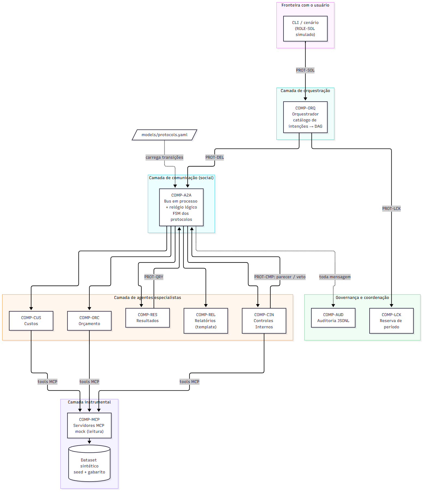

# DSM2 — Arquitetura e protótipo inicial

**Projeto:** Sistema Multiagente de Controladoria (INE5628 — Sistemas Multiagentes).
**Autores:** Danrley Moreira Ribeiro (23102664) e Jiliard Mai Peifer (23103129).
Enunciado: [`enunciados/DSM2.txt`](../../enunciados/DSM2.txt).

Protótipo executável do Orquestrador e dos cinco agentes especializados sobre um barramento A2A
em processo, com dados sintéticos e MCP mock. O que pertence à DSM3 e à DSM4 (LLM, memória,
Approval Gate, métricas, dashboard) **não** está nesta entrega; ver [Limitações](../../docs/dsm2/limitacoes.md).

## Como executar

Requer Python 3.12 ou superior. Não usa rede nem API paga.

```bash
python -m venv .venv
.venv/bin/pip install -e . -r requirements-dev.txt        # Windows: .venv\Scripts\pip
.venv/bin/python -m fin_mas list                           # cenários disponíveis
.venv/bin/python -m fin_mas run --scenario fechar_mes --seed 42
.venv/bin/python -m pytest                                 # 118 testes, tudo offline
```

Sem instalar o pacote: `PYTHONPATH=src python -m fin_mas ...`.

### Cenário controlado de depuração

```bash
python -m fin_mas run --scenario depuracao --trace trace.jsonl   # seed 1337
python -m fin_mas replay trace.jsonl SOL-001                     # reconstrói a causalidade pelo conversation_id
```

O cenário planta uma violação de SoD (crítica), um lançamento de outra competência (não crítica) e a
perda do primeiro `request` ao Agente de Orçamento. Na trilha aparecem, em ordem: a mensagem
perdida (`DEL-002`), o `TIMEOUT` em `t=031`, o reenvio (`DEL-003`), o `veto` do Agente de Controles
Internos, o aviso ao aprovador, o waiver, a publicação com duas ressalvas e o `inform` final.
Duas execuções com a mesma seed geram o mesmo hash do trace.

## Arquitetura



Fonte editável: [`modelos-editaveis/arquitetura_camadas.mmd`](modelos-editaveis/arquitetura_camadas.mmd).
Decisões e alternativas: [ADR-003 (runtime)](../../docs/dsm2/ADR-003-runtime-python-deterministico.md) e
[ADR-004 (A2A e MCP mock)](../../docs/dsm2/ADR-004-a2a-bus-e-mcp-mock.md).

| Camada | Código (`src/fin_mas/`) | Componente |
|---|---|---|
| Orquestração | `agents/orq.py` | `COMP-ORQ` |
| Agentes especialistas | `agents/cus.py`, `orc.py`, `res.py`, `cin.py`, `rel.py` | `COMP-CUS`, `COMP-ORC`, `COMP-RES`, `COMP-CIN`, `COMP-REL` |
| Comunicação (A2A) | `core/bus.py`, `fsm.py`, `message.py`, `agent.py` | `COMP-A2A` |
| Instrumental (MCP mock) | `mcp/gateway.py`, `env/dataset.py` | `COMP-MCP` |
| Governança e coordenação | `services/audit.py`, `services/locks.py` | `COMP-AUD`, `COMP-LCK` |
| Cenários e CLI | `env/scenarios.py`, `cli.py` | — |

Estado, conhecimento e memória são atributos separados de cada agente ([tabela](../../docs/dsm2/prototipo.md)).

## Testes

`python -m pytest` executa 118 testes (unitários e e2e). Catorze casos da DSM1 passaram a
`executado` em `models/tests.yaml`: TEST-01 a 10, 14, 16, 24 e 26. O `tools/trace.py --check`
garante que cada um tem uma função pytest com o mesmo nome. Tabela completa em
[Testes iniciais](../../docs/dsm2/testes.md).

## Checklist do enunciado

| Entregável | Onde |
|---|---|
| Código-fonte executável | `src/fin_mas/` |
| Diagrama de arquitetura | `diagramas/arquitetura_camadas.png` |
| README.md | este arquivo |
| Testes iniciais | `tests/` e `docs/dsm2/testes.md` |
| USO_DE_IA.md | [`USO_DE_IA.md`](USO_DE_IA.md) |

| Requisito | Onde |
|---|---|
| Justificar arquitetura e runtime | ADR-003, ADR-004 e `docs/dsm2/arquitetura.md` |
| Agentes principais e ambiente | seis agentes, bus, MCP mock e dataset sintético |
| Estado/conhecimento e comportamento básico | `estado`, `conhecimento` e `memoria` por agente; DAG, reenvio, veto e waiver |
| Ao menos uma interação | `fechar_mes` (PROT-SOL, LCK, DEL, QRY, CMP) |
| Cenário controlado para depuração | `depuracao` (seed 1337) |
| Limitações | [`docs/dsm2/limitacoes.md`](../../docs/dsm2/limitacoes.md) |

## Limitações principais

Sem LLM (só template), sem memória de longo prazo, sem Approval Gate (a publicação não espera
aprovação humana), bus em um único fio, MCP somente leitura, aprovador simulado e correção de
lançamento não implementada. Detalhes em [`docs/dsm2/limitacoes.md`](../../docs/dsm2/limitacoes.md).

## Documentação navegável

`make docs` gera o site Sphinx; a versão publicada está em
<https://fin-dept-multiagents-project.readthedocs.io>. O histórico da entrega está no
[`CHANGELOG.md`](../../CHANGELOG.md).
