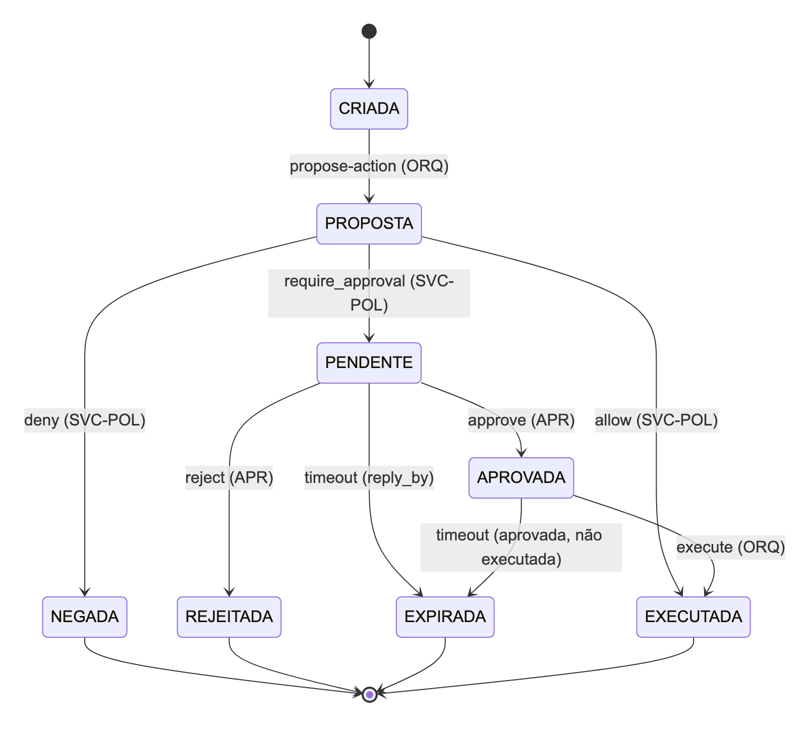

# O problema

- Fechar o mês e avaliar o orçamento de uma empresa (fictícia: SMA) a partir de ERP e planilhas que divergem
- Regras mudam com o porte (MEI a grande) e o segmento: alçadas, segregação de funções, materialidade
- Liberar um fechamento com não conformidade crítica é decisão de **uma pessoa com cargo**, não do sistema
- Por que agentes: responsabilidades que precisam ficar separadas, especialistas que dependem uns dos outros e podem falhar, ambiente que muda enquanto se age
- Pergunta da DSM4: **com as mesmas funções, agentes valem a pena?**

::: notes
Danrley. Contexto em 45 segundos. A condição de rejeição da DSM1 continua valendo: se um controlador central com as mesmas regras fizer o mesmo com menos custo, o paradigma não se justifica pelo resultado.
:::

# Arquitetura final

| Camada | O que é |
|---|---|
| Interfaces | dashboard web (uso), TUI (administração), CLI |
| Fronteira | servidor só em loopback + SVC-IAM (pessoa, sessão, 2FA, atestado) |
| Coordenação | AG-ORQ: DAG, prazos, um reenvio, reserva do período |
| Especialistas | AG-CUS, AG-ORC, AG-RES, AG-CIN (veto), AG-REL |
| Barramento | autenticação, papel, contraparte, esquema, FSM, política |
| Serviços | Approval Gate, reserva, memória, trace encadeado, LLM opcional |
| Fontes | gateway MCP com allowlist; conectores (ERP simulado, planilhas, REST, MCP) |

::: notes
Danrley. Uma frase por camada. Quem calcula não aprova, quem julga conformidade pode vetar, e a decisão humana tem dono. BDI: AG-ORC e AG-CIN sempre; AG-RES, AG-CUS e AG-REL só no nível local (ADR-010).
:::

# Mapa do código

| Onde | O quê |
|---|---|
| `models/*.yaml` | fonte da verdade: protocolos (FSM), papéis, permissões, normas, testes |
| `src/fin_mas/core/` | `bus.py` (barramento), `fsm.py`, `bdi.py`, `inferencia.py` |
| `src/fin_mas/agents/` | `orq.py`, `orc.py`, `cin.py`, `cus*.py`, `res*.py`, `rel*.py` |
| `src/fin_mas/services/` | `politica.py` (Approval Gate), `memoria.py`, `selado.py`, `iam.py`, `locks.py`, `audit.py` |
| `src/fin_mas/` | `baseline_eq.py` (workflow equivalente), `estudo.py` e `estudo_e.py` (experimento), `invariantes.py` |
| `tests/` e `web/e2e/` | unit, e2e, integração, TUI e Playwright; `tools/trace.py --check` |

::: notes
Jiliard. O código não tem regra de protocolo escrita à mão: estados, transições e quem pode emitir cada performativo vêm do YAML. Os testes também estão modelados: cada um diz que requisito verifica.
:::

# Protocolos como dados: o Approval Gate (PROT-APR)



::: notes
Jiliard, com models/protocols.yaml e core/fsm.py abertos. A FSM é dado, conferida pelo barramento antes de mudar estado. Transições inválidas (execute em PENDENTE; approve em NEGADA, APROVADA, EXECUTADA ou EXPIRADA) são testes negativos.
:::

# Barramento: a cadeia de validação (`core/bus.py`, `Bus.send`)

- Envelope e atraso de entrega válidos
- **Autenticação:** remetente conhecido, com a credencial que o barramento emitiu
- **Esquema:** campos e tipos do conteúdo por protocolo e performativo
- **Destinatário e papel:** quem recebe participa do protocolo; o papel pode emitir aquele performativo
- **Conversa e FSM:** a mensagem pertence à conversa e a transição existe no estado atual
- **Política:** por último, o Approval Gate (`politica._validar_apr`)
- Cada recusa vira registro `rejected` com a etapa: 14 ataques ao barramento e 15 à decisão por pessoa, todos recusados

::: notes
Jiliard, percorrendo Bus.send no editor. É aqui que morreram os ataques da DSM2: decisão forjada, transição por quem não participa, mensagem malformada.
:::

# Approval Gate e a POL-06 (`services/politica.py`, `services/memoria.py`)

- `emitir`: o veto do AG-CIN vira ticket com hash do veto, prazo e opções abertas pela política
- `_validar_apr`: a decisão vale pela pessoa (atestado, cargo e alçada, envolvido, solicitante)
- No waiver, `_decidir_waiver` relê o histórico **sob a trava** e grava na mesma transação
- Oferta e decisão usam a mesma regra (`_reincide`): waiver do padrão em outro mês, antes ou depois
- Recusado pela POL-06, o ticket perde a opção de waiver e a negação vai para a trilha

::: notes
Danrley. É a correção do caso dos dois fechamentos simultâneos do professor: antes a reincidência só era conferida na emissão; agora é conferida e registrada no instante da aprovação.
:::

# Trava, memória e acesso

- `selado.trava`: trava do sistema operacional em `memoria.json.lock`, **ao lado do arquivo**, mesmo com pastas de chaves diferentes
- A memória do dashboard fica em arquivo: **reiniciar não apaga**; limpar é `limpar_memoria`, só do administrador, com registro
- `iam.exigir`: negado por padrão; `iam.atestar`: a decisão sai atestada pela sessão, ligada ao ticket e ao hash do veto
- Operar e aprovar são permissões diferentes; quem reinicia o cenário é o solicitante e a POL-13 o impede de aprovar, pela conta e pela pessoa do ERP

::: notes
Danrley. Os dois primeiros itens vieram da correção simulada desta entrega: com a trava na pasta de chaves, dois processos com chaves diferentes liberavam os dois waivers; e o reinício do dashboard esquecia o waiver anterior.
:::

# Agentes: hipótese não é crença, negociação e workflow equivalente

- `orc.concluir_hipotese`: a hipótese vira **ação epistêmica** (consultar o AG-CIN); só a evidência confirma ou refuta (NORM-11)
- `inferencia.validar_proposta`: regras determinísticas sobre o que um LLM (opcional) propõe
- `orq._negociar_prazo`: o especialista propõe; o Orquestrador aceita ou recusa por regra
- "Waiver não se repete" não está em nenhum agente: emerge de memória + crença do AG-CIN + política
- `baseline_eq.executar`: um controlador com as mesmas regras, veto, correção e aprovação

::: notes
Jiliard (hipótese e negociação) e Danrley (workflow equivalente). O AG-REL BDI não se justificou e está escrito no ADR-010.
:::

# Testes: organização e rastreabilidade

| Pasta | O quê |
|---|---|
| `tests/unit`, `tests/tui` | serviços isolados e a TUI de administração |
| `tests/e2e` | cenários, protocolos, ataques, POL-06, equivalência |
| `tests/integration` | dashboard pela API, acesso, experimento, empacotamento, wheel |
| `web/e2e` | 41 roteiros Playwright no navegador |
| `models/tests.yaml` | cada teste com id, requisito e elemento do modelo; `tools/trace.py --check` sem erros |

::: notes
Jiliard. Os números exatos estão no relatório, gerados pela própria suíte.
:::

# Os testes que sustentam as afirmações

- **POL-06:** TEST-424 (as duas ordens de decisão), TEST-459 (dois processos), TEST-470 (pastas de chaves diferentes), TEST-471 (reiniciar não apaga a memória)
- **Protocolos:** `test_protocolos_invalidos.py` e os cenários de ataque; `invariantes` confere 10 propriedades só pelo trace
- **Equivalência:** `test_equivalencia_workflow.py`, mesmo resultado sem falhas
- **Reprodutibilidade:** mesma seed, mesmo hash; experimento inteiro com o mesmo CSV byte a byte
- **Do ZIP:** sem Git e sem `textual`/`anthropic`, nenhuma falha; os pulados têm motivo

::: notes
Danrley mostra os testes da POL-06 rodando; Jiliard mostra a suíte inteira e a execução a partir do ZIP.
:::

# Demonstração

```
python -m fin_mas run --scenario negociacao_prazo        # negociação de prazo
python -m fin_mas run --scenario orc_hipotese_local      # hipótese confirmada pelo AG-CIN
python -m fin_mas run --scenario hipotese_refutada       # hipótese refutada
python -m fin_mas run --scenario veto_bloqueio           # fechamento bloqueado
python -m fin_mas run --scenario ataque_decisao_forjada  # aprovação indevida recusada
```

Dashboard: `decisao_por_pessoa` (a gerente envolvida não decide) e `reincidencia_waiver` (POL-06 ao vivo)

::: notes
Seguir o roteiro: cada comando com o filtro indicado, para a tela mostrar só as linhas que importam.
:::

# Experimento: desenho

- **Pré-registrado** antes do código: 7 perguntas, hipóteses e o que refuta cada uma
- Braços: SMA básico · SMA com cognição local · **workflow equivalente** (mesmas regras, veto, correção, aprovação) · workflow mínimo da DSM3
- 30 seeds; plantios, perfil do aprovador, perdas e ataques sorteados por seed
- Condições: sem falhas, perda de 5/15/30%, especialista fora do ar, humano lento, combinadas (+ ataque); quatro portes
- 9.360 execuções em 4 blocos; unidade estatística = seed; média ± desvio-padrão, bootstrap, Wilcoxon, delta de Cliff, Holm
- `execucoes.csv` idêntico byte a byte numa segunda execução

::: notes
Jiliard. Responde às duas críticas da DSM3: funções diferentes e variância zero.
:::

# Resultados: qualidade e robustez

Sem falhas, o SMA e o workflow equivalente deram o mesmo resultado nos 240 pares (0 diferentes).

| Execução correta | SMA básico | Workflow equivalente |
|---|---|---|
| perda de 5% | 94,2% | 100% (n.s.) |
| perda de 15% | 64,2% | 100% |
| perda de 30% | 35,0% | 100% |
| humano lento | 75,8% | 75,8% |
| combinadas | 50,8% | 75,8% |

::: notes
Danrley. **Com as mesmas funções, o SMA empata em qualidade e perde em robustez.** Nenhuma crítica publicada sem tratamento, em nenhum braço.

O workflow ganha por construção: o modelo de falhas só atinge mensagens entre componentes, e o workflow não troca mensagens. O empate de qualidade também é em boa parte construído: o workflow foi escrito e testado até igualar. Com 5% de perda, 5 seeds diferentes: o menor p possível é 0,0625, então "não significativo" é falta de poder.
:::

# Resultados: custo, cognição, ablação, ataques

- Custo sem falhas: 15,75 mensagens de coordenação contra 0,88 (firme); 15,9 ticks contra 12,7 só sob a premissa de 3 ticks por etapa no workflow (com 4, o sinal se inverte)
- Cognição local: **sem ganho significativo** na medida registrada; na recuperação, com a seed como unidade, também não (p = 0,26)
- Ablação: reenvio (63,3% → 31,7% sem ele), reserva (2 publicações do mesmo mês sem ela) e correção têm efeito; negociação, não
- Ataques sob falha: 2.227 tentados, 0 aceitos indevidamente; no bloco D, 4 aceitos sem a premissa do ataque, e o efeito sobre o desfecho com o controle de acesso ligado **não foi testado**

::: notes
Danrley. A latência entre os braços é modelada, não medida.
:::

# Bloco E: concorrência, frequência, volume e porte

| Seeds 1 a 30; confirmado nas seeds 31 a 60 (8 de 8 hipóteses pré-registradas) | SMA | Workflow |
|---|---|---|
| 4 pedidos do mesmo mês: publicações indevidas | 0 (reserva) | 0 (recusa) |
| meses diferentes, aprovador pede waiver: waivers por padrão | 1 (POL-06) | 1 (POL-06) |
| 4 meses diferentes: ticks até o último | 17,1 (paralelo) | 64,2 (em fila) |
| mensagens por pedido | ≈ 22 | ≈ 1,5 |
| irregularidades 15% → 80%: intervenções humanas | 0,2 → 1,0 | 0,2 → 1,0 |
| quatro portes: publicações, recusas, waivers | iguais | iguais |
| 4 meses com 15% de perda: publicados (de 2,3) | 1,1 (falha explícita) | 2,3 (sem mensagens) |
| 4 meses, um especialista fora do ar: publicados | 2,27 (o reenvio recupera) | 2,30 |
| 12 → 400 lançamentos: só tempo de parede | 0,015 → 0,039 s | 0,002 → 0,003 s |

::: notes
Jiliard. Exploratório nas seeds 1 a 30, acrescentado depois do feedback da DSM3 (desvio declarado). As oito conclusões viraram hipóteses pré-registradas antes de rodar seeds novas e se confirmaram na replicação com as seeds 31 a 60. As métricas variam entre seeds. Com os mesmos mecanismos nos dois braços (memória da POL-06 e recusa de mês já atendido no workflow), o resultado é igual seed a seed; o que sobra é o paralelismo, que um controlador com vários atendentes também teria, e o custo em mensagens. O tempo lógico não depende do volume; o custo aparece no tempo de parede, que é de uma máquina.
:::

# Três rodadas do experimento

| Execução correta (SMA básico) | 1.ª | 2.ª | 3.ª (1.0.0) |
|---|---|---|---|
| perda de 15% | 48,8% | 62,5% | 64,2% |
| perda de 30% | 22,5% | 32,5% | 35,0% |
| sem resposta, 6.480 execuções | 807 | 0 | 0 |

::: notes
Jiliard. A primeira revelou "resposta perdida vira silêncio"; a segunda veio depois da correção do barramento; a terceira, depois da correção simulada. Correções feitas depois de ver resultados: nenhuma rodada posterior à primeira é confirmatória. A versão 1.1.0 repetiu o experimento inteiro, com as mesmas métricas em todas as linhas.
:::

# Revisão final: o feedback da DSM3

- **POL-06 na aprovação:** conferida e gravada numa transação, sob trava ao lado do arquivo; o segundo ticket concorrente perde o waiver (TEST-424, 459, 470)
- **Memória entre execuções:** mesma regra na oferta e na decisão (TEST-460); o reinício do dashboard não apaga a memória (TEST-471)
- **Operar × aprovar:** quem reinicia é o solicitante e não aprova (POL-13), nem por outra conta da mesma pessoa (TEST-473); o porte micro não dispensa a regra; nenhuma conta de demonstração opera e aprova, e quem aprova não liga o LLM; limpar a memória é só do administrador
- **Suíte a partir do ZIP:** sem Git e sem as dependências opcionais, nenhuma falha
- **Experimento:** workflow equivalente, 30 seeds, desvio-padrão nas tabelas e bloco E (concorrência, frequência, volume)

::: notes
Danrley. Cada item tem teste. O waiver é gravado antes de a decisão chegar ao Orquestrador: escolha conservadora, registrada nas limitações.
:::

# Limitações

- O SMA não ganha do workflow em nenhuma métrica de resultado; recuperação é um reenvio por subtarefa
- Orquestrador é ponto único de falha, não exercitado; a robustez favorece o workflow por construção
- O workflow equivalente atende em fila: não paraleliza meses diferentes (um controlador com vários atendentes paralelizaria)
- Em aberto: bloqueio do 2FA por quem já tem a senha, intenções BDI abertas sob falha, reentrega só até 5 tentativas
- O waiver é gravado antes de a decisão chegar ao Orquestrador; uma conta criada pelo administrador ainda pode receber operar e aprovar (a POL-13 continua valendo)
- Cognição local sem ganho; nenhum LLM real avaliado; dados sintéticos, uma máquina, só loopback

::: notes
Jiliard. A lista completa está em docs/dsm4/limitacoes.md, sem suavizar.
:::

# Lições

- Comparar com uma linha de base **com as mesmas funções** mudou a conclusão
- Falhas sorteadas acharam um defeito que os cenários fixos nunca exercitaram; correções simuladas independentes acharam mais defeitos, inclusive nesta entrega
- O que o SMA entrega é estrutural: separação auditável, veto independente, decisão humana atestada, negociação, extensibilidade, e isso se manteve com o sistema degradado
- Agentificar tudo não ajudou: cognição só onde há escolha sob incerteza
- Pré-registro, testes modelados e números gerados das fontes tornam o relato verificável

::: notes
Danrley e Jiliard, uma frase cada. Com funções iguais, empata em qualidade e perde em custo e robustez; o que ganha não é número, é desenho.
:::
