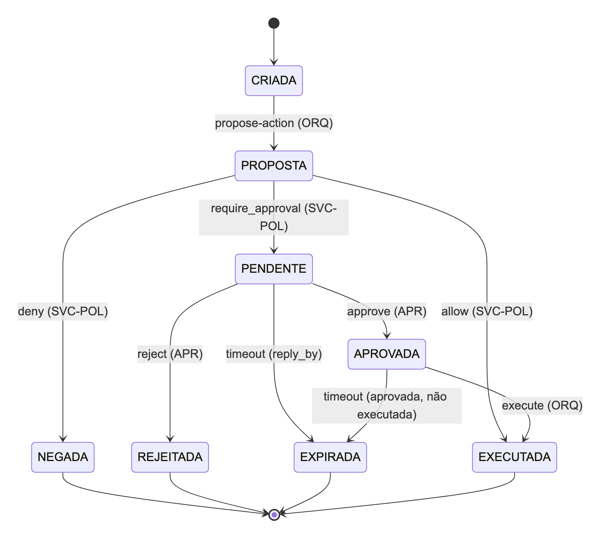

# O problema

- Fechar o mês e avaliar o orçamento de uma empresa (fictícia: SMA) a partir de ERP e planilhas que divergem
- Regras mudam com o porte (MEI a grande) e o segmento: alçadas, segregação de funções, materialidade
- Liberar um fechamento com não conformidade crítica é decisão de **uma pessoa com cargo**, não do sistema
- Por que agentes: responsabilidades que precisam ficar separadas, especialistas que dependem uns dos outros e podem falhar, ambiente que muda enquanto se age
- Pergunta da DSM4: **com as mesmas funções, agentes valem a pena?**

::: notes
Contexto em 40 segundos. A condição de rejeição da DSM1 continua valendo: se um controlador central com as mesmas regras fizer o mesmo com menos custo, o paradigma não se justifica pelo resultado.
:::

# Arquitetura final

| Camada | O que é |
|---|---|
| Interfaces | dashboard web (uso), TUI (administração), CLI |
| Fronteira | servidor só em loopback + SVC-IAM (pessoa, sessão, 2FA, atestado) |
| Coordenação | AG-ORQ: DAG, prazos, um reenvio, reserva do período |
| Especialistas | AG-CUS, AG-ORC, AG-RES, AG-CIN (veto), AG-REL |
| Barramento | autenticação, papel, contraparte, esquema, FSM, política |
| Serviços | Approval Gate, reserva, memória, trace encadeado, LLM opcional |
| Fontes | gateway MCP com allowlist; conectores (ERP simulado, planilhas, REST, MCP) |

::: notes
Uma frase por camada. O ponto: quem calcula não aprova, quem julga conformidade pode vetar, e a decisão humana tem dono. BDI: AG-ORC e AG-CIN sempre; AG-RES, AG-CUS e AG-REL só no nível local (ADR-010).
:::

# Um protocolo: o Approval Gate (PROT-APR)

{height=60%}

- O veto do AG-CIN vira ticket: hash do veto, aprovador, prazo e opções abertas pela política
- Decisão vale pela pessoa autenticada: atestado, cargo e alçada, quem participou não decide, quem pediu não aprova
- Transições inválidas testadas: `execute` em PENDENTE; `approve` em NEGADA, APROVADA, EXECUTADA ou EXPIRADA

::: notes
Mostrar que a FSM é dado (models/protocols.yaml), conferida pelo barramento antes de mudar estado. Cada transição inválida é um teste negativo.
:::

# Coordenação e comportamento coletivo

- Delegação com prazo e reenvio; consulta direta AG-ORC → AG-CIN sem passar pelo Orquestrador
- Veto → decisão humana → correção no ERP → AG-CIN percebe de novo e reavalia
- Reserva do período: único mecanismo que impede dois fechamentos do mesmo mês
- Negociação de prazo: o especialista propõe, o Orquestrador decide por regras
- **"Waiver não se repete"** não está em nenhum agente: emerge de memória (SVC-MEM) + crença do AG-CIN + política
- Sem falhas, 77% das decisões são tomadas fora do Orquestrador (84% com os especialistas BDI)

::: notes
O comportamento coletivo é observável no trace: em reincidencia_waiver a decisão de agosto vira memória, muda a crença de setembro, o veto e as opções da política.
:::

# Segurança: o que não passa

- Barramento: remetente com credencial, papel por performativo, contraparte, esquema, FSM, política
- Ataques com o veto pendente: 14 ao barramento e 15 à decisão por pessoa, todos recusados
- Acesso avançado: segundo fator, alçada por pessoa, delegação, dupla aprovação, escalonamento
- Invariantes conferidos só pelo trace, em qualquer execução: nenhuma publicação vetada sem tratamento, nenhum efeito externo sem aprovação, toda solicitação com resposta, nenhum segredo no trace
- Trace com cadeia de hashes, selo e âncora pública

::: notes
Os quatro ataques do feedback da DSM2 estão no cenário ataque_decisao_forjada. Fora do modelo: quem controla o processo ou a pasta de chaves.
:::

# Cognição: proposta não é crença

- BDI onde há escolha sob incerteza, tempo ou dependência: **AG-RES sim, AG-CUS pouco, AG-REL não** (ADR-010)
- Hipóteses vêm de regras locais ou, opcionalmente, de um LLM, e passam por 5 regras determinísticas
- Sem número no texto, sem ação proposta, só evidência que o agente já tem
- Hipótese aceita gera **ação epistêmica** (consultar, conferir histórico, negociar prazo); quem muda a avaliação é a evidência
- LLM desligado por padrão, proibido no Orquestrador, Custos e Controles; fora do experimento

::: notes
Guardrail não é outro LLM: é verificação determinística. O AG-REL BDI não acrescenta capacidade: uma tabela de decisão faria o mesmo, e isso está escrito no ADR.
:::

# Experimento: desenho

- **Pré-registrado** antes do código: 7 perguntas, hipóteses e o que refuta cada uma
- Braços: SMA básico · SMA com cognição local · **workflow equivalente** (mesmas regras, veto, correção, aprovação) · workflow mínimo da DSM3
- 30 seeds; plantios, perfil do aprovador, perdas e ataques sorteados por seed
- Condições: sem falhas, perda de 5/15/30%, especialista fora do ar, humano lento, combinadas (+ ataque)
- 9.360 execuções em 4 blocos; unidade estatística = seed; bootstrap, Wilcoxon, delta de Cliff, Holm
- `execucoes.csv` idêntico byte a byte numa segunda execução

::: notes
Responde às duas críticas da DSM3: funções diferentes e variância zero.
:::

# Resultados: qualidade e robustez

| Execução correta | SMA básico | Workflow equivalente |
|---|---|---|
| sem falhas (pares diferentes) | 0 de 240 | — |
| perda de 5% | 94,2% | 100% (n.s.) |
| perda de 15% | 62,5% | 100% |
| perda de 30% | 32,5% | 100% |
| humano lento | 75,8% | 75,8% |
| combinadas | 50,8% | 75,8% |

**Com as mesmas funções, o SMA empata em qualidade e perde em robustez.** Nenhuma crítica publicada sem tratamento, em nenhum braço.

::: notes
O workflow ganha por construção: o modelo de falhas só atinge mensagens entre componentes. O experimento mede o tamanho da conta. A vantagem de qualidade da DSM3 era das funções, não do paradigma.
:::

# Resultados: custo, cognição, ablação, duas rodadas

- Custo sem falhas: 15,75 mensagens de coordenação contra 0,88; 15,9 ticks contra 12,7
- Cognição local: **sem ganho significativo** na medida registrada (sinal exploratório, não significativo)
- Ablação: reenvio (61,7% → 31,7% sem ele), reserva (2 publicações do mesmo mês sem ela) e correção têm efeito; negociação, não
- Ataques sob falha: 2.227 tentados, 0 aceitos indevidamente
- Duas rodadas: a primeira achou um defeito (807 execuções sem resposta); corrigido, 0 na segunda, que **não é confirmatória**

::: notes
O que não mudou entre as rodadas é o que vale como resultado: empate de qualidade, custo maior, robustez menor, zero ataque aceito, zero crítica publicada.
:::

# Demonstração

```
python -m fin_mas run --scenario veto_correcao
python -m fin_mas run --scenario res_insumo_faltante --porte grande
python -m fin_mas run --scenario ataque_acesso
python -m pytest tests/e2e/test_equivalencia_workflow.py -q
python -m fin_mas experimento --rapido --out /tmp/exp
python -m fin_mas serve --demo
```

Plano B: `./iniciar.sh replay` e os resultados versionados em `docs/dsm4/resultados/`

::: notes
Seguir docs/dsm4/demonstracao.md: veto e correção, falha explícita com reenvio, ataque recusado, o teste da equivalência, o aparato do experimento e o dashboard.
:::

# Limitações

- O SMA não ganha do workflow em nenhuma métrica de resultado; recuperação é um reenvio por subtarefa
- Orquestrador é ponto único de falha, não exercitado; a robustez favorece o workflow por construção
- Cognição local sem ganho; nenhum LLM real avaliado
- Raiz de confiança no processo e na pasta de chaves; o cofre não cifra
- Dados sintéticos; uma máquina, só loopback; nenhum conector de fornecedor

::: notes
A lista completa está em docs/dsm4/limitacoes.md, sem suavizar.
:::

# Lições

- Comparar com uma linha de base **com as mesmas funções** mudou a conclusão
- Falhas sorteadas acharam um defeito que os cenários fixos nunca exercitaram
- O que o SMA entrega é estrutural: separação auditável, veto independente, decisão humana atestada, negociação, extensibilidade, e isso se manteve com o sistema degradado
- Agentificar tudo não ajudou: cognição só onde há escolha sob incerteza
- Pré-registro e números gerados das fontes tornam o relato honesto verificável

::: notes
Fechar com a frase do resumo: com funções iguais, empata em qualidade e perde em custo e robustez; o que ganha não é número, é desenho.
:::
